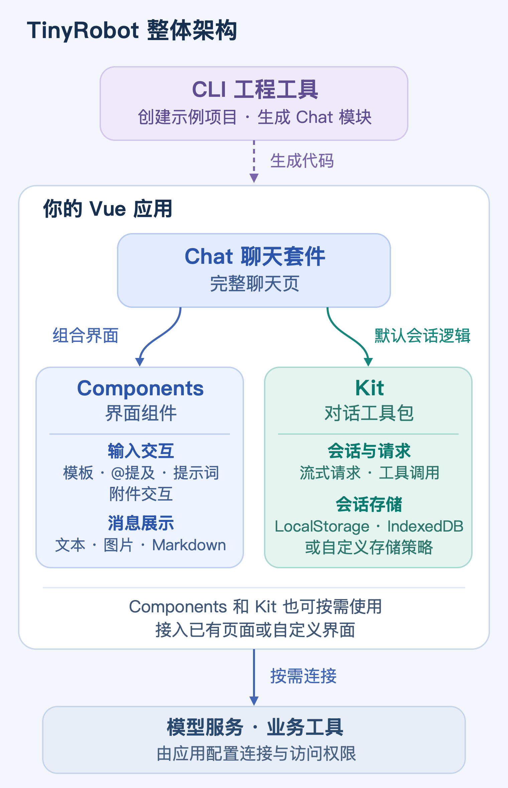
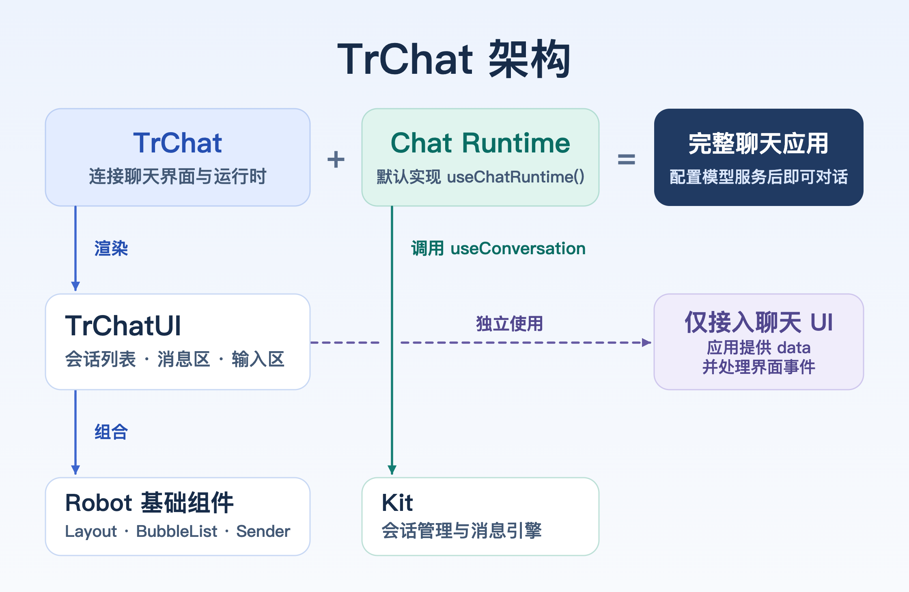
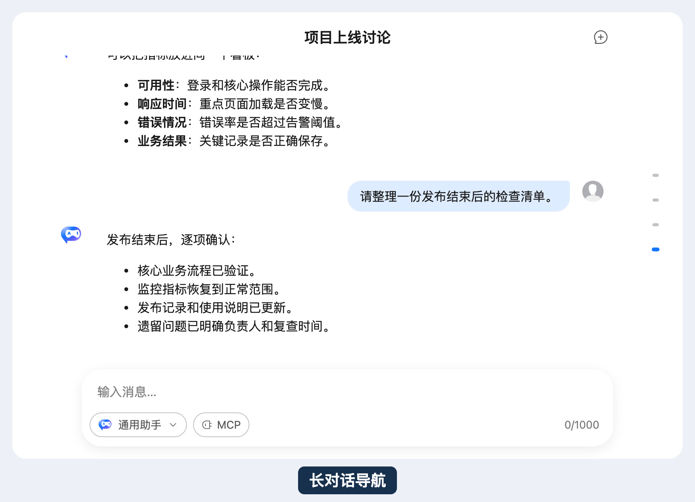

TinyRobot 1.0 正式发布！

TinyRobot 是 OpenTiny 社区开源的 Vue 3 AI 组件库与应用开发套件，用于构建智能对话应用和业务助手。

我们开发智能对话应用或业务助手时，通常需要处理用户输入、模型回复的流式展示和会话历史管理，还要考虑如何连接外部工具与业务系统。

TinyRobot 1.0 将完整聊天页封装为独立的 Chat 套件，并带来模型选择器、统一扩展面板和工具调用确认。你可以采用套件组合好的聊天流程，也可以按需使用组件和工具，将助手接入已有业务。

一起看看 TinyRobot 1.0 能为你的项目带来什么：

- [产品概览](#认识-tinyrobot)：产品组成、核心能力与接入方式。
- [Chat 套件](#trchat-聊天套件几行代码搭建完整聊天页)：搭建完整聊天页，按需接入业务。
- [模型选择](#模型选择器切换设置一步到位)：切换模型，调整思考强度等设置。
- [扩展管理](#统一扩展面板工具与技能的集中入口)：集中管理工具、技能与业务扩展。
- [工具调用确认](#工具调用确认让用户决定是否执行)：执行前由用户确认，待确认状态可保存与恢复。
- [输入交互](#多行输入首行提示)：首行标签提示任务，切换时可保留草稿。
- [其他更新与升级](#其他更新与升级提示)：功能改进、问题修复与升级注意事项。

## 认识 TinyRobot

TinyRobot 的四个部分各有分工：

- **完整聊天套件 Chat**（`@opentiny/tiny-robot-chat`）：提供可配置的完整聊天页，用于搭建聊天应用或接入业务页面。
- **界面组件 Components**（`@opentiny/tiny-robot`）：在已有页面中按需组合聊天交互组件，页面结构由应用安排。
- **会话与模型请求工具包 Kit**（`@opentiny/tiny-robot-kit`）：管理对话状态、模型请求和扩展调用，也可独立配合自定义界面使用。
- **工程工具 CLI**（`@opentiny/tiny-robot-cli`）：创建示例项目，或在已有 Vue 项目中生成聊天模块。



对 Vue 项目而言，接入 TinyRobot 还有这些便利：

- **沿用熟悉的开发方式。** Components 和 Chat 基于 Vue 3 和 TypeScript，可通过属性、事件和插槽定制界面；Kit 则通过组合式函数组织会话与请求逻辑。界面遵循 OpenTiny Design 体系，可通过 CSS 变量和主题配置适配品牌外观与亮暗色模式。
- **融入现有业务。** 可按需将 Components 组件或 Chat 界面加入已有页面，保留应用原有的会话与发送逻辑；模型请求、会话存储和工具调用则可通过 Chat 套件或独立的 Kit 对接自有服务。业务鉴权、文件上传和具体业务操作由应用实现。

完整的组件用法和配置可查阅[官方文档](https://docs.opentiny.design/tiny-robot)。

想快速体验聊天流程，可以用 CLI 创建示例项目。环境要求：Vue 3.3+、Node.js 22.12+，推荐使用 pnpm 管理依赖。

```bash
pnpm dlx @opentiny/tiny-robot-cli@1.0 create my-chat
cd my-chat
cp .env.example .env.local
# 编辑 .env.local，填入所用模型服务的测试 Key：
# 阿里百炼：VITE_ALIYUN_DASHSCOPE_KEY；DeepSeek：VITE_DEEPSEEK_API_KEY
pnpm install
pnpm dev
```

启动后可以看到聊天页，并选择已配置服务的模型试发消息。

在已有 Vue 3 + Vite 项目中，可以从项目根目录生成聊天模块。

```bash
pnpm dlx @opentiny/tiny-robot-cli@1.0 add chat
cp -n .env.example .env.local
# 编辑 .env.local，填写所用服务的测试 Key（同上）。
```

接着将下面的代码片段合并到现有 `src/App.vue`，保留原有业务内容：

```vue
<script setup lang="ts">
import TinyRobotChat from './tiny-robot-chat/TinyRobotChat.vue'
</script>

<template>
  <!-- 原有业务内容 -->
  <TinyRobotChat />
</template>
```

完成环境配置和组件接入后，安装依赖并使用项目原有的启动命令。以下以 `pnpm` 为例：

```bash
pnpm install
pnpm dev
```

启动后页面右下角会显示 AI 头像入口，点击即可打开聊天浮窗。完整选项见 [CLI 接入文档](https://docs.opentiny.design/tiny-robot/guide/cli-integration)。

接下来从 Chat 套件的接入方式开始，再看模型选择、扩展管理和工具调用确认如何配合聊天流程。

## TrChat 聊天套件：几行代码，搭建完整聊天页

在 Chat 搭建的聊天页里，用户可以切换会话、继续追问，并查看流式回复；配合应用的附件处理，还可以发送图片消息。1.0 将这些交互整合进独立的 `@opentiny/tiny-robot-chat` 包，提供完整聊天页 `TrChat` 和可单独使用的聊天界面 `TrChatUI`。


图片上传由应用处理，所用模型需支持图片输入。

为了让聊天界面适配不同的会话和模型请求逻辑，`TrChat` 引入了 Runtime。它统一提供界面所需的会话、消息和输入状态，以及发送、取消、切换会话等操作。单独使用 `TrChatUI` 时，则由应用直接提供数据，并通过事件接收用户操作。

`TrChat` 和 `TrChatUI` 都可以通过 `ui` 配置布局和输入区。例如，`ui.sender.toolbar` 可以重排或隐藏模型选择和工具扩展入口，也可以添加应用自己的按钮。

### 接入方式

你可以根据项目中会话与请求逻辑的来源，选择对应的用法：

- **采用套件提供的会话与请求逻辑**：使用 `TrChat` + `useChatRuntime`，从模型服务配置开始搭建聊天页。
- **保留应用自己的会话与发送逻辑**：使用 `TrChatUI`，由应用提供界面数据并处理提交。
- **保留已有的 Kit 会话**：使用 `TrChat` + `useChatRuntimeFromConversation`，将现有会话适配到完整聊天页。



手动接入时，在已有项目中安装 Chat 和基础组件。

```bash
pnpm add @opentiny/tiny-robot-chat@1.0 @opentiny/tiny-robot@1.0
```

### 采用套件的会话与请求逻辑

下面先搭建文本聊天页。将示例放进 `App.vue`，填入模型 ID 和浏览器可访问的接口地址，即可发送文本并查看流式回复。

接口需兼容 OpenAI 的 `/chat/completions` 并支持流式响应。需要密钥时，可使用后端转发地址，由服务端完成鉴权。

```vue
<script setup lang="ts">
import { TrChat, useChatRuntime } from '@opentiny/tiny-robot-chat'
import '@opentiny/tiny-robot/dist/style.css'
import '@opentiny/tiny-robot-chat/dist/style.css'

const runtime = useChatRuntime({
  modelProviders: [
    {
      type: 'openai',
      apiUrl: 'https://your-service.example.com/v1/chat/completions',
      models: [{ id: 'your-model-id', label: '应用助手' }],
    },
  ],
})
</script>

<template>
  <TrChat :runtime="runtime" />
</template>
```

### 保留应用自己的会话与发送逻辑

已有自己的会话与发送逻辑时，可以沿用它们接入聊天界面。`TrChatUI` 负责展示消息，输入和提交仍由应用处理。

使用同样的两个包，将下面的示例放进 `App.vue`。应用持有输入草稿和消息列表，并通过 `chatViewData` 将消息交给 `TrChatUI` 展示。点击发送后，由应用的 `handleAppSubmit` 更新消息并清空输入。示例使用本地模拟回复，接入业务时可在这里调用自己的接口。

```vue
<script setup lang="ts">
import { computed, ref } from 'vue'
import { TrChatUI, type ChatMessageItem, type ChatUIData } from '@opentiny/tiny-robot-chat'
import '@opentiny/tiny-robot/dist/style.css'
import '@opentiny/tiny-robot-chat/dist/style.css'

// 沿用业务原有的草稿和消息列表，此处用本地状态演示。
const appDraft = ref('')
const appMessages = ref<ChatMessageItem[]>([])
// 新增界面适配：将业务数据转为 TrChatUI 格式，会话信息仅为演示。
const chatViewData = computed<ChatUIData>(() => ({
  conversation: { activeId: 'demo', title: '应用助手' },
  bubble: { messages: appMessages.value },
}))

function handleAppSubmit({ text }: { text: string }) {
  if (!text.trim()) return
  appMessages.value.push({ role: 'user', content: text }, { role: 'assistant', content: `已收到：${text}` })
  appDraft.value = ''
}
</script>

<template>
  <TrChatUI :data="chatViewData" v-model:input-value="appDraft" @submit="handleAppSubmit" />
</template>
```

### 复用已有的 Kit 会话

项目已经用 Kit 管理会话时，可以沿用现有的模型请求和会话配置。将已有 `useConversation` 调用的返回值交给 `useChatRuntimeFromConversation`，再把 Runtime 传给 `TrChat`，就能接入完整聊天页。

```vue
<script setup lang="ts">
import { TrChat, useChatRuntimeFromConversation } from '@opentiny/tiny-robot-chat'
import '@opentiny/tiny-robot/dist/style.css'
import '@opentiny/tiny-robot-chat/dist/style.css'

// appConversation 为业务已有的 useConversation 返回值
const runtime = useChatRuntimeFromConversation({ conversation: appConversation })
</script>

<template>
  <TrChat :runtime="runtime" />
</template>
```

界面配置和数据接入的完整说明见 [1.0 版 Chat 接入文档](https://docs.opentiny.design/tiny-robot/suites/quick-start)。

### 长对话导航：快速定位历史消息

对话变长后，可以通过消息目录找回前面的提问。点击一条提问即可跳回对应消息，手动滚动时目录也会高亮当前项。



消息目录沿用 Anchor 组件的导航能力，1.0 将它集成到 Chat。目录默认关闭，配置 `ui.anchor` 开启后，可从用户消息生成目录，默认在视口宽度达到 768px 时显示。

```vue
<TrChat :runtime="runtime" :ui="{ anchor: {} }" />
```

### 可拖动、可缩放的聊天浮窗

在工作台或业务页面中，可以将聊天页作为浮窗打开，边查看业务内容边与助手对话。1.0 将 Layout 已有的浮窗能力接入 Chat，拖动或缩放时，会话列表、消息区和输入框会随窗口一起移动或调整大小。


`TrChat` 和 `TrChatUI` 都通过 `ui.layout.surface` 配置显示方式。浮动窗口默认可拖动，设置 `resizable: true` 后，还可拖动窗口边缘调整大小。

```vue
<TrChat
  :runtime="runtime"
  :ui="{ layout: { surface: { mode: 'floating', floatingOptions: { resizable: true } } } }"
/>
```

## 模型选择器：切换、设置一步到位

为助手配置多个模型后，用户可以在同一个面板里按分组浏览、搜索和切换，并调整思考强度、联网搜索等可用设置。1.0 新增的模型选择器已集成到 Chat，也可以单独用于应用自己的界面。


使用 Chat 时，在 `modelProviders` 中配置模型，再用 `features` 声明可调整的设置，输入区就会显示内置选择器。延续前面的文本聊天示例，用下面的配置替换 `runtime` 创建部分；阿里百炼的后端代理地址和模型 ID 需填真实值，鉴权由后端处理。

```ts
const runtime = useChatRuntime({
  modelProviders: [{
    type: 'qwen',
    apiUrl: 'https://your-service.example.com/v1/chat/completions',
    models: [{
      id: 'your-model-id',
      label: '联网助手',
      features: [{ key: 'search', label: '联网搜索', type: 'switch' }],
    }],
  }],
})
```

Runtime 会按模型服务预设将设置映射为请求参数；上面的 `qwen` 预设把 `search` 映射为请求中的 `enable_search`。服务参数有不同约定时，可在模型配置中用 `mapFeatureValues` 覆盖映射，实际可用功能仍取决于模型服务。

如果只需要选择界面，可以独立使用 `TrModelSelector`。下面的示例可浏览、搜索模型，并为「推理助手」调整思考强度；它只演示选择和结果展示，不调用模型服务。

```vue
<script setup lang="ts">
import { ref } from 'vue'
import { TrModelSelector, type ModelSelectorOption, type ModelSelectorSnapshot } from '@opentiny/tiny-robot'
import '@opentiny/tiny-robot/dist/style.css'

const selection = ref<ModelSelectorSnapshot>()
const models: ModelSelectorOption[] = [
  { id: 'general', label: '通用助手', group: '通用模型' },
  {
    id: 'reasoner',
    label: '推理助手',
    group: '推理模型',
    features: [{
      key: 'reasoning',
      label: '思考强度',
      type: 'select',
      options: [{ value: 'balanced', label: '均衡' }, { value: 'deep', label: '深度' }],
    }],
  },
]

function handleChange(current: ModelSelectorSnapshot) {
  selection.value = current
}
</script>

<template>
  <TrModelSelector
    default-value="general"
    :models="models"
    searchable
    :close-on-select="false"
    @change="handleChange"
  />
  <p v-if="selection">{{ selection.modelId }} · {{ selection.featureValues.reasoning }}</p>
</template>
```

在这个示例中，`group` 决定分组，`features` 声明设置项；`change` 事件提供当前选择，应用将模型 ID 和设置显示在选择器下方。接入实际服务时，模型请求和参数转换仍由应用处理。

## 统一扩展面板：工具与技能的集中入口

助手接入多种工具和技能时，统一扩展面板让用户从同一个入口查看和管理它们。1.0 新增这一面板，将工具服务、技能和应用自己的扩展集中展示，并补充技能导入、详情等配套界面。


连接外部工具时，可通过 MCP 协议对接服务。使用 Chat 时，在 `mcpServers` 中配置已有服务，默认适配器会衔接安装状态管理、启停、工具发现与调用。将前文文本聊天示例中的 `runtime` 创建部分替换为下面的配置。模型代理地址、模型 ID 和工具地址需填真实值；模型鉴权由后端处理，工具服务需支持 Streamable HTTP 且可从浏览器访问。

```ts
const runtime = useChatRuntime({
  modelProviders: [{
    type: 'openai',
    apiUrl: 'https://your-service.example.com/v1/chat/completions',
    models: [{ id: 'your-model-id', label: '项目助手' }],
  }],
  mcpServers: [{
    id: 'project-tools',
    name: '项目工具',
    baseUrl: 'https://your-service.example.com/mcp/project-tools',
    // installed: true, // 初始化时加载工具，仍需手动启用；默认 false
  }],
})
```

面板按安装状态分组，支持搜索和标签筛选。这里的「安装」是连接已准备好的服务，不会下载或运行服务端程序。通过表单新增 MCP 服务时，应用需处理 `mcp-create-server` 事件。

需要为助手补充可复用的任务说明与资源时，可以使用 Skills。对应的管理页或业务工具页可通过 `ui.extensions.tabs` 加入 Chat。下面沿用上面的 `runtime`；`businessTabs` 是应用提供的页签数组（ID 不能用保留的 `mcp`），`handleBusinessAction` 是应用处理操作并更新条目的函数：

```vue
<TrChat
  :runtime="runtime"
  :ui="{ extensions: { tabs: businessTabs } }"
  @extension-action="handleBusinessAction"
/>
```

自定义页签的操作由 `extension-action` 交回应用。Kit 可加载、存储 Skills，并在对话中使用它们；应用负责将管理入口与这些流程连接。

如果只需要管理界面，可以独立使用 `TrExtensionManager`。点击「安装」等操作会触发 `action` 事件，由应用执行并更新条目。下面用「日程助手」模拟安装状态变化，不连接真实服务。

```vue
<script setup lang="ts">
import { reactive } from 'vue'
import { TrExtensionManager, type ExtensionManagerActionEvent, type ExtensionManagerTab } from '@opentiny/tiny-robot'
import '@opentiny/tiny-robot/dist/style.css'

const calendar = reactive<ExtensionManagerTab['items'][number]>({
  id: 'calendar',
  name: '日程助手',
  installed: false,
  actions: [{ id: 'install', type: 'button', label: '安装' }],
})
const tabs = [{ id: 'mcp', label: 'MCP', items: [calendar] }]

function handleAction({ action }: ExtensionManagerActionEvent) {
  if (action.id !== 'install') return
  calendar.installed = true
  calendar.actions = []
}
</script>

<template>
  <TrExtensionManager :tabs="tabs" @action="handleAction" />
</template>
```

## 工具调用确认，让用户决定是否执行

助手要保存内容或修改业务数据时，应用可以先请用户确认。1.0 在 Kit 已有工具调用能力上增加暂停、恢复和拒绝操作，用户在对话卡片上选择「允许」或「拒绝」，就能决定这次工具调用是否继续；保存好待确认状态与原会话消息后，刷新页面也能继续确认。


下面以 Kit 的工具调用插件 `toolPlugin` 为例，配置 `shouldPauseToolCall`，让「保存周报」工具在执行前等待确认。

```ts
toolPlugin({
  getTools,
  callTool,
  shouldPauseToolCall: (call) => call.function.name === 'save_report',
})
```

用户点击「允许」或「拒绝」后，应用将选择结果交给当前会话，继续或拒绝对应的工具调用。

> 本示例需配置会话存储策略，可通过 `useConversation` 的 `storage` 属性指定，并将 `autoSaveMessages` 设为 `true`，自动保存暂停状态和消息。刷新后重新打开原会话，即可继续确认。

<details>
<summary>完整可运行示例</summary>

在已安装 Chat 和基础组件的项目中安装 Kit。

```bash
pnpm add @opentiny/tiny-robot-kit@1.0
```

将下面的代码放进 `App.vue`，输入「保存周报」并发送，即可试用确认卡片。示例使用本地模拟，会话数据保存在浏览器本地存储中；数据仍保留时，刷新后可从会话列表重新打开待确认的对话。

```vue
<script setup lang="ts">
import { TrChat, useChatRuntimeFromConversation, type ChatBubbleEventPayload } from '@opentiny/tiny-robot-chat'
import {
  localStorageStrategyFactory,
  TOOL_REJECT_COMMAND,
  TOOL_RESUME_COMMAND,
  toolPlugin,
  useConversation,
  type ResponseProvider,
} from '@opentiny/tiny-robot-kit'
import '@opentiny/tiny-robot/dist/style.css'
import '@opentiny/tiny-robot-chat/dist/style.css'

const tool = {
  type: 'function' as const,
  function: { name: 'save_report', description: '保存周报', parameters: { type: 'object', properties: {} } },
}
const saved = '周报已保存到演示工作区。'
const responseProvider: ResponseProvider = async ({ messages }) => {
  const last = messages.at(-1)
  const id = crypto.randomUUID()
  const hasResult = last?.role === 'tool'
  return {
    id,
    object: 'chat.completion',
    created: 0,
    model: 'local-demo',
    system_fingerprint: null,
    choices: [{
      index: 0,
      delta: undefined,
      logprobs: null,
      finish_reason: hasResult ? 'stop' : 'tool_calls',
      message: hasResult
        ? { role: 'assistant', content: last.content === saved ? saved : '已取消保存。' }
        : {
            role: 'assistant',
            content: '周报已整理好，请确认是否保存。',
            tool_calls: [{ id, index: 0, type: 'function', function: { name: tool.function.name, arguments: '{}' } }],
          },
    }],
  }
}

const conversation = useConversation({
  storage: localStorageStrategyFactory({ key: 'chat-tool-approval' }),
  autoSaveMessages: true,
  useMessageOptions: {
    responseProvider,
    plugins: [toolPlugin({
      getTools: () => [tool],
      callTool: async () => saved,
      shouldPauseToolCall: (call) => call.function.name === tool.function.name,
    })],
  },
})
const runtime = useChatRuntimeFromConversation({ conversation })

async function handleBubbleEvent({ name, payload }: ChatBubbleEventPayload) {
  if (name !== 'tool-call:resume' && name !== 'tool-call:reject') return
  if (!payload || typeof payload !== 'object' || !('toolCallId' in payload)) return
  const { toolCallId } = payload
  if (typeof toolCallId !== 'string' || !toolCallId) return

  const command = name === 'tool-call:resume' ? TOOL_RESUME_COMMAND : TOOL_REJECT_COMMAND
  await conversation.activeConversation.value?.engine.dispatchCommand(command, { toolCallId })
}
</script>

<template>
  <TrChat :runtime="runtime" @bubble-event="handleBubbleEvent" />
</template>
```

</details>

## 多行输入首行提示

同一个输入框用于多种任务时，首行标签可以提醒用户当前是在起草「客户回复」，还是生成「交接摘要」。1.0 的 Sender 新增 `input-prefix` 插槽，可在多行输入框的首行显示标签等自定义内容。应用更新任务标签并沿用原输入状态，用户就能继续编辑已输入的正文。


插槽只占首行空间，换行后正文从输入区左侧开始。下面的示例由应用分别保存任务和草稿，切换任务时保留草稿，提交时一同记录所选任务和正文。

<details>
<summary>查看任务切换与提交示例</summary>

```vue
<script setup lang="ts">
import { ref } from 'vue'
import { TrSender } from '@opentiny/tiny-robot'
import '@opentiny/tiny-robot/dist/style.css'

const labels = { reply: '客户回复', handoff: '交接摘要' }
type Task = keyof typeof labels
const task = ref<Task | null>(null)
const draft = ref('')
const submitted = ref<{ task: Task; text: string } | null>(null)

function submit(text: string) {
  if (!task.value) return
  submitted.value = { task: task.value, text }
  draft.value = ''
}
</script>

<template>
  <button type="button" @click="task = 'reply'">起草客户回复</button>
  <button type="button" @click="task = 'handoff'">生成交接摘要</button>
  <TrSender v-model="draft" mode="multiple" submit-type="ctrlEnter" :disabled="!task" @submit="submit">
    <template v-if="task" #input-prefix><span>{{ labels[task] }}</span></template>
  </TrSender>
  <p v-if="submitted">已提交 · {{ labels[submitted.task] }} · {{ submitted.text }}</p>
</template>
```

</details>

## 其他更新与升级提示

### 新增能力

- **Sender** 的模板下拉菜单可通过 `templateOptions.appendTo` 指定挂载容器，例如弹窗内的输入面板。 by @SonyLeo in [#394](https://github.com/opentiny/tiny-robot/pull/394)
- **TrChat** 让应用可以回填提示词、清空输入文本或将焦点移到输入框。 by @SonyLeo in [#464](https://github.com/opentiny/tiny-robot/pull/464)
- **Kit** 可用 `maxToolRounds` 限制一次用户回合中的工具调用批次数；同一批可以包含多个工具调用。 by @gene9831 in [#406](https://github.com/opentiny/tiny-robot/pull/406)

### 问题修复

- **Sender** 修复中文输入法组合输入时丢字，以及同时启用模板和 @提及时丢失提及数据的问题。 by @SonyLeo in [#472](https://github.com/opentiny/tiny-robot/pull/472) [#482](https://github.com/opentiny/tiny-robot/pull/482)
- **TrChat** 修复只有附件的消息无法提交的问题。 by @SonyLeo in [#485](https://github.com/opentiny/tiny-robot/pull/485)
- **BubbleList** 修复启用自动滚动后，图片等内容延迟加载时，消息区未继续自动滚动到底部的问题。 by @gene9831 in [#421](https://github.com/opentiny/tiny-robot/pull/421)
- **Layout** 修复窄屏下抽屉侧栏被裁切的问题。 by @gene9831 in [#489](https://github.com/opentiny/tiny-robot/pull/489)

### 升级提示

已有项目升级到 1.0 前，请留意以下接入变化：

- `McpServerPicker` 和 `Container` 已弃用，现有代码仍可使用；新接入建议采用 `ExtensionManager` 和 `Layout`。
- CLI 的 `add chat` 生成结构调整为 `src/tiny-robot-chat/` 目录，聊天组件、配置和样式集中放在该模块内。已有接入需检查导入路径，并按生成的 README 核对样式引入和环境配置。1.0 还增加变更预览与运行时版本选项，可在生成前确认接入范围。

完整变更见[更新日志](https://docs.opentiny.design/tiny-robot/guide/update-log)。

## 小结

1.0 是 TinyRobot 组件能力进一步完善的新起点。

- **完整套件便于复用。** 独立的 Chat 套件整合界面与会话逻辑，减少搭建聊天页时的重复组装。
- **选择与管理更集中。** 模型搜索、切换与功能设置放在同一面板，工具、技能和业务扩展也有统一的管理入口。
- **工具执行可由用户确认。** 应用可让工具调用在执行前暂停，由用户选择允许或拒绝，为修改业务数据保留确认环节。

你可以用完整聊天页搭建新的对话应用，也可以在已有项目中按需加入聊天组件，保留原有的会话与请求逻辑。

未来，TinyRobot 将继续完善组件能力、打磨开发体验，让开发者更方便地构建贴合业务需求的 AI 助手。

## 参与社区

[TinyRobot 官网](https://docs.opentiny.design/tiny-robot)提供组件文档与接入说明。欢迎在 [TinyRobot 仓库](https://github.com/opentiny/tiny-robot)查看源码，通过 [Issues](https://github.com/opentiny/tiny-robot/issues) 反馈问题，或通过 [Pull Requests](https://github.com/opentiny/tiny-robot/pulls) 参与共建。

可在 [OpenTiny GitHub](https://github.com/opentiny) 查看更多开源项目。
