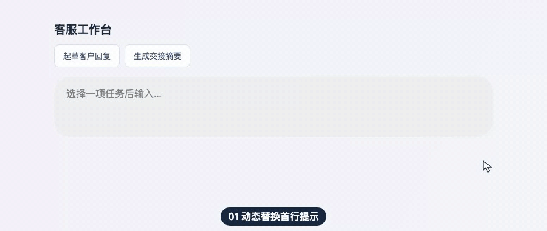

TinyRobot 1.0 正式发布！

TinyRobot 是 OpenTiny 社区开源的 Vue 3 AI 组件库与应用开发套件，用于构建智能对话应用和业务助手。

给 Vue 项目加一个 AI 助手，通常要把聊天界面、模型请求和会话管理接起来。TinyRobot 以 0.5 的聊天组件、会话工具和 CLI 模板里的实验版 `TrChat` 为基础，把这三部分整合进独立的 Chat 套件（`@opentiny/tiny-robot-chat`）。新项目可以直接用正式版 `TrChat` 搭建完整聊天页。已有应用可以只接入 `TrChatUI`，沿用自己的数据和发送逻辑，也可以把 Kit 管理的会话接到 `TrChat` 上。

这一版也补齐了业务助手常用的交互。用户可以按模型调整思考强度、联网搜索等设置，在同一个面板管理 MCP 服务、Skills 和业务扩展，并在工具执行前决定是否允许。给现有项目加聊天时，CLI 可以先预览变更，生成的聊天模块由应用挂载到需要的页面。

## 新能力概览

- [TrChat 聊天套件](#trchat-聊天套件) 可接入整套聊天功能，也可只接入聊天界面。[长对话导航](#长对话导航)可跳到指定提问，[聊天浮窗](#聊天浮窗)支持拖动和缩放。
- [模型选择](#模型选择) 搜索模型并在同一个面板里调整当前模型支持的设置。
- [统一扩展面板](#统一扩展面板) 在一处管理 MCP 服务、Skills 和应用自己的扩展。
- [工具调用确认](#工具调用确认) 在工具执行前决定是否允许，保存待确认状态后也可以刷新页面再继续。
- [多行输入首行提示](#多行输入首行提示) 在输入框首行显示自定义提示，切换任务时保留已输入的正文。

## TrChat 聊天套件

0.5 提供了会话列表、消息区和输入框等独立组件，`add chat` 模板也已引用实验版 `TrChat`。1.0 的 Chat 套件提供完整的聊天页 `TrChat`、可单独使用的界面组件 `TrChatUI`，以及连接界面与模型请求的 Runtime。

### 接入方式

- **需要完整的聊天页** → `TrChat` + `useChatRuntime`
- **只接入界面，沿用自己的会话和发送逻辑** → `TrChatUI`
- **已有会话由 Kit（TinyRobot 的会话与模型请求工具包）管理** → `TrChat` + `useChatRuntimeFromConversation`


**接入整套聊天功能。** 用 `useChatRuntime` 配置模型服务。

```vue
<TrChat :runtime="runtime" />
```

**只接入聊天界面。** 沿用应用已有的会话数据和发送逻辑。

```vue
<TrChatUI :data="chatData" @submit="handleSubmit" />
```

想快速试用，可以用 CLI 创建一个使用 `TrChat` 和 Runtime 的示例项目。请用 Node.js 22.12 或更高版本运行示例项目。

```bash
pnpm dlx @opentiny/tiny-robot-cli@1.0 create my-chat
cd my-chat
pnpm install
pnpm dev
```

按生成项目的 README 配置模型服务后，即可试发消息。已有项目也可用 `pnpm dlx @opentiny/tiny-robot-cli@1.0 add chat` 生成聊天模块，运行 `pnpm install` 后将它挂载到页面。

手动接入时，在已有的 Vue 3 项目中安装 Chat 和基础组件。

```bash
pnpm add @opentiny/tiny-robot-chat@1.0 @opentiny/tiny-robot@1.0
```

**接入完整聊天页。** 将示例放进 `App.vue`，填入模型 ID 和浏览器可访问的接口地址。接口需兼容 OpenAI 的 `/chat/completions` 并支持流式响应。需要密钥时，可用后端转发地址，由服务端完成鉴权。

```vue
<script setup lang="ts">
import { TrChat, useChatRuntime } from '@opentiny/tiny-robot-chat'
import '@opentiny/tiny-robot/dist/style.css'
import '@opentiny/tiny-robot-chat/dist/style.css'

const runtime = useChatRuntime({
  modelProviders: [
    {
      type: 'openai',
      apiUrl: 'https://your-service.example.com/v1/chat/completions',
      models: [{ id: 'your-model-id', label: '应用助手' }],
    },
  ],
})
</script>

<template>
  <TrChat :runtime="runtime" />
</template>
```

**只接入聊天界面。** 使用同样的两个包，将下面的示例放进 `App.vue`。应用持有输入草稿和消息列表，并通过 `chatViewData` 将消息交给 `TrChatUI` 展示。点击发送后，由应用的 `handleAppSubmit` 更新消息并清空输入。示例使用本地模拟回复，接入业务时可在这里调用自己的接口。

```vue
<script setup lang="ts">
import { computed, ref } from 'vue'
import { TrChatUI, type ChatMessageItem, type ChatUIData } from '@opentiny/tiny-robot-chat'
import '@opentiny/tiny-robot/dist/style.css'
import '@opentiny/tiny-robot-chat/dist/style.css'

const appDraft = ref('')
const appMessages = ref<ChatMessageItem[]>([])
const chatViewData = computed<ChatUIData>(() => ({
  conversation: { activeId: 'demo', title: '应用助手' },
  bubble: { messages: appMessages.value },
}))

function handleAppSubmit({ text }: { text: string }) {
  if (!text.trim()) return
  appMessages.value.push({ role: 'user', content: text }, { role: 'assistant', content: `已收到：${text}` })
  appDraft.value = ''
}
</script>

<template>
  <TrChatUI :data="chatViewData" v-model:input-value="appDraft" @submit="handleAppSubmit" />
</template>
```

**复用 Kit 会话。** 下面用应用已有的存储和消息配置演示接入方式。把 `useConversation` 的返回值交给 `useChatRuntimeFromConversation`，再将 Runtime 传给 `TrChat`。如果页面已经调用了 `useConversation`，直接使用它的返回值即可。

```vue
<script setup lang="ts">
import { TrChat, useChatRuntimeFromConversation } from '@opentiny/tiny-robot-chat'
import { useConversation } from '@opentiny/tiny-robot-kit'
import '@opentiny/tiny-robot/dist/style.css'
import '@opentiny/tiny-robot-chat/dist/style.css'

const appConversation = useConversation({
  storage: appConversationStorage, // 应用已有的会话存储
  useMessageOptions: appMessageOptions, // 应用已有的模型请求和插件配置
})
const runtime = useChatRuntimeFromConversation({ conversation: appConversation })
</script>

<template>
  <TrChat :runtime="runtime" />
</template>
```

接上 Runtime 后，用户可以切换会话、在原对话里追问，并看到回复逐步出现。应用也可以从输入区的拖放和粘贴事件取得文件，接入自己的附件上传和发送流程。


### 长对话导航

在长对话里，点击消息目录中的一条提问，Chat 就会跳回那条消息。手动滚动对话时，目录也会高亮当前项。


0.5 提供了独立的 Anchor 组件。1.0 的 Chat 可通过 `ui.anchor` 从用户消息生成目录，默认在视口宽度达到 768px 时显示。

```vue
<TrChat :runtime="runtime" :ui="{ anchor: {} }" />
```

### 聊天浮窗

完整的聊天页现在可以直接作为浮窗打开。1.0 把 0.5 的 Layout 浮窗能力接入了 Chat，拖动或缩放时，会话列表、消息区和输入框都随窗口一起移动或调整大小。


`TrChat` 和 `TrChatUI` 都通过 `ui.layout.surface` 配置显示方式。浮动窗口默认可拖动，设置 `resizable: true` 后还可以拉伸窗口边缘调整大小。

```vue
<TrChat
  :runtime="runtime"
  :ui="{ layout: { surface: { mode: 'floating', floatingOptions: { resizable: true } } } }"
/>
```

用 `ui.sender.toolbar` 还可以重排或隐藏模型选择和 MCP 入口，或添加应用自己的按钮。

## 模型选择

用户可以在同一个面板里按分组浏览或搜索模型，并调整所选模型支持的设置，例如思考强度或联网搜索。


在 `TrModelSelector` 中，`group` 决定模型在哪个分组里，`features` 决定选中该模型后可以调整哪些设置。
下面的示例中，选中「推理助手」也能继续在面板里调整思考强度。示例监听 `change` 事件，将当前模型 ID 和设置显示在选择器按钮上。

```vue
<script setup lang="ts">
import { ref } from 'vue'
import { TrModelSelector, type ModelSelectorOption, type ModelSelectorSnapshot } from '@opentiny/tiny-robot'
import '@opentiny/tiny-robot/dist/style.css'

const selection = ref<ModelSelectorSnapshot>()
const models: ModelSelectorOption[] = [
  { id: 'general', label: '通用助手', group: '通用模型' },
  {
    id: 'reasoner',
    label: '推理助手',
    group: '推理模型',
    features: [{
      key: 'reasoning',
      label: '思考强度',
      type: 'select',
      options: [{ value: 'balanced', label: '均衡' }, { value: 'deep', label: '深度' }],
    }],
  },
]

function handleChange(current: ModelSelectorSnapshot) {
  selection.value = current
}
</script>

<template>
  <TrModelSelector
    default-value="general"
    :models="models"
    searchable
    :close-on-select="false"
    @change="handleChange"
  />
  <p v-if="selection">{{ selection.modelId }} · {{ selection.featureValues.reasoning }}</p>
</template>
```

## 统一扩展面板

0.5 的 Kit 已支持在对话中使用 Skills。1.0 新增 `ExtensionManager`，把 MCP 服务、Skills 和应用自己的扩展放进同一个面板。


面板按安装状态分组，支持搜索和标签筛选。应用也可以通过 `ui.extensions.tabs` 在 Chat 右栏加入 Skills 或业务工具页。点击「安装」时，应用收到 `action` 事件，完成安装后更新条目。下面用「日程助手」模拟一次安装。

```vue
<script setup lang="ts">
import { reactive } from 'vue'
import { TrExtensionManager, type ExtensionManagerActionEvent, type ExtensionManagerTab } from '@opentiny/tiny-robot'
import '@opentiny/tiny-robot/dist/style.css'

const calendar = reactive<ExtensionManagerTab['items'][number]>({
  id: 'calendar',
  name: '日程助手',
  installed: false,
  actions: [{ id: 'install', type: 'button', label: '安装' }],
})
const tabs = [{ id: 'mcp', label: 'MCP', items: [calendar] }]

function handleAction({ action }: ExtensionManagerActionEvent) {
  if (action.id !== 'install') return
  calendar.installed = true
  calendar.actions = []
}
</script>

<template>
  <TrExtensionManager :tabs="tabs" @action="handleAction" />
</template>
```

## 工具调用确认

0.5 的 Kit 已能调用工具。1.0 允许应用指定哪些调用要在执行前暂停，让用户直接在对话卡片上选择「允许」或「拒绝」。应用保存待确认状态和会话消息后，用户刷新页面、重新打开原会话，仍可继续确认。


在应用已有的 `toolPlugin` 配置中加入 `shouldPauseToolCall`。例如，下面让「保存周报」工具在执行前等待确认。

```ts
toolPlugin({
  getTools,
  callTool,
  shouldPauseToolCall: (call) => call.function.name === 'save_report',
})
```

用户点击「允许」或「拒绝」后，应用通过 `TrChat` 的 `bubble-event`，向当前会话发送对应的 `TOOL_RESUME_COMMAND` 或 `TOOL_REJECT_COMMAND`。

<details>
<summary>完整可运行示例</summary>

在已安装 Chat 和基础组件的项目中安装 Kit。

```bash
pnpm add @opentiny/tiny-robot-kit@1.0
```

将下面的代码放进 `App.vue`，输入「保存周报」并发送，即可试用确认卡片。模型回复和保存操作都在本地模拟。示例通过 `shouldPauseToolCall` 指定哪些工具需要确认，并用 `autoSaveMessages` 将消息存入浏览器。刷新后可从会话列表重新打开待确认的对话。

```vue
<script setup lang="ts">
import { TrChat, useChatRuntimeFromConversation, type ChatBubbleEventPayload } from '@opentiny/tiny-robot-chat'
import {
  localStorageStrategyFactory,
  TOOL_REJECT_COMMAND,
  TOOL_RESUME_COMMAND,
  toolPlugin,
  useConversation,
  type ResponseProvider,
} from '@opentiny/tiny-robot-kit'
import '@opentiny/tiny-robot/dist/style.css'
import '@opentiny/tiny-robot-chat/dist/style.css'

const tool = {
  type: 'function' as const,
  function: { name: 'save_report', description: '保存周报', parameters: { type: 'object', properties: {} } },
}
const saved = '周报已保存到演示工作区。'
const responseProvider: ResponseProvider = async ({ messages }) => {
  const last = messages.at(-1)
  const id = crypto.randomUUID()
  const hasResult = last?.role === 'tool'
  return {
    id,
    object: 'chat.completion',
    created: 0,
    model: 'local-demo',
    system_fingerprint: null,
    choices: [{
      index: 0,
      delta: undefined,
      logprobs: null,
      finish_reason: hasResult ? 'stop' : 'tool_calls',
      message: hasResult
        ? { role: 'assistant', content: last.content === saved ? saved : '已取消保存。' }
        : {
            role: 'assistant',
            content: '周报已整理好，请确认是否保存。',
            tool_calls: [{ id, index: 0, type: 'function', function: { name: tool.function.name, arguments: '{}' } }],
          },
    }],
  }
}

const conversation = useConversation({
  storage: localStorageStrategyFactory({ key: 'chat-tool-approval' }),
  autoSaveMessages: true,
  useMessageOptions: {
    responseProvider,
    plugins: [toolPlugin({
      getTools: () => [tool],
      callTool: async () => saved,
      shouldPauseToolCall: (call) => call.function.name === tool.function.name,
    })],
  },
})
const runtime = useChatRuntimeFromConversation({ conversation })

async function handleBubbleEvent({ name, payload }: ChatBubbleEventPayload) {
  if (name !== 'tool-call:resume' && name !== 'tool-call:reject') return
  if (!payload || typeof payload !== 'object' || !('toolCallId' in payload)) return
  const { toolCallId } = payload
  if (typeof toolCallId !== 'string' || !toolCallId) return

  const command = name === 'tool-call:resume' ? TOOL_RESUME_COMMAND : TOOL_REJECT_COMMAND
  await conversation.activeConversation.value?.engine.dispatchCommand(command, { toolCallId })
}
</script>

<template>
  <TrChat :runtime="runtime" @bubble-event="handleBubbleEvent" />
</template>
```

</details>

## 多行输入首行提示

1.0 的 Sender 新增 `input-prefix` 插槽，可在多行输入框的首行显示标签等自定义内容。切换任务时，应用可以更新首行标签，已输入的正文仍可接着编辑。



插槽只占首行空间，换行后正文从输入区左侧开始。下面的示例提交时会记录所选任务和正文。

```vue
<script setup lang="ts">
import { ref } from 'vue'
import { TrSender } from '@opentiny/tiny-robot'
import '@opentiny/tiny-robot/dist/style.css'

const labels = { reply: '客户回复', handoff: '交接摘要' }
type Task = keyof typeof labels
const task = ref<Task | null>(null)
const draft = ref('')
const submitted = ref<{ task: Task; text: string } | null>(null)

function submit(text: string) {
  if (!task.value) return
  submitted.value = { task: task.value, text }
  draft.value = ''
}
</script>

<template>
  <button type="button" @click="task = 'reply'">起草客户回复</button>
  <button type="button" @click="task = 'handoff'">生成交接摘要</button>
  <TrSender v-model="draft" mode="multiple" submit-type="ctrlEnter" :disabled="!task" @submit="submit">
    <template v-if="task" #input-prefix><span>{{ labels[task] }}</span></template>
  </TrSender>
  <p v-if="submitted">已提交 · {{ labels[submitted.task] }} · {{ submitted.text }}</p>
</template>
```

## 其他改进与修复

### 新增能力

- **Sender** 支持通过 `appendTo` 指定模板下拉菜单的挂载容器，例如弹窗内的输入面板。 by @SonyLeo in [#394](https://github.com/opentiny/tiny-robot/pull/394)
- **TrChat** 支持应用回填提示词、清空输入文本或将焦点移到输入框。 by @SonyLeo in [#464](https://github.com/opentiny/tiny-robot/pull/464)
- **Kit** 支持用 `maxToolRounds` 限制一次用户提问可触发的工具调用批次。 by @gene9831 in [#406](https://github.com/opentiny/tiny-robot/pull/406)

### 问题修复

- **Sender** 修复中文输入法组合输入时丢字，以及同时启用模板和 @提及时丢失提及数据的问题。 by @SonyLeo in [#472](https://github.com/opentiny/tiny-robot/pull/472) [#482](https://github.com/opentiny/tiny-robot/pull/482)
- **TrChat** 修复只有附件的消息无法提交的问题。 by @SonyLeo in [#485](https://github.com/opentiny/tiny-robot/pull/485)
- **BubbleList** 修复启用自动滚动后，图片等内容延迟加载导致消息区没有继续跟随底部的问题。 by @gene9831 in [#421](https://github.com/opentiny/tiny-robot/pull/421)
- **Layout** 修复窄屏下抽屉侧栏被裁切的问题。 by @gene9831 in [#489](https://github.com/opentiny/tiny-robot/pull/489)

## 关于 TinyRobot

TinyRobot 是 OpenTiny 社区开源的 Vue 3 AI 组件库与应用开发套件，可用于构建智能对话应用和业务助手。

[TinyRobot 官网](https://docs.opentiny.design/tiny-robot)

欢迎在 GitHub 查看源码、反馈问题或提交改进。[TinyRobot 仓库](https://github.com/opentiny/tiny-robot) · [Issues](https://github.com/opentiny/tiny-robot/issues) · [Pull Requests](https://github.com/opentiny/tiny-robot/pulls) · [OpenTiny GitHub](https://github.com/opentiny)
