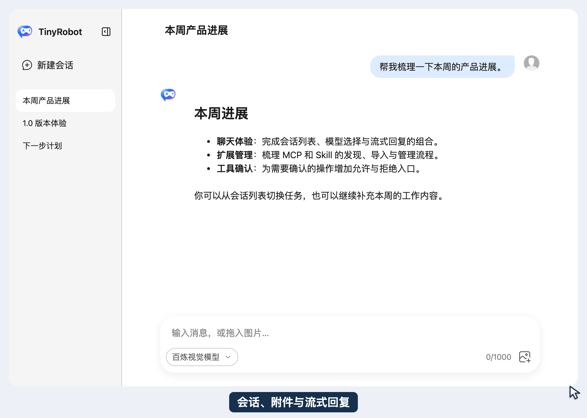
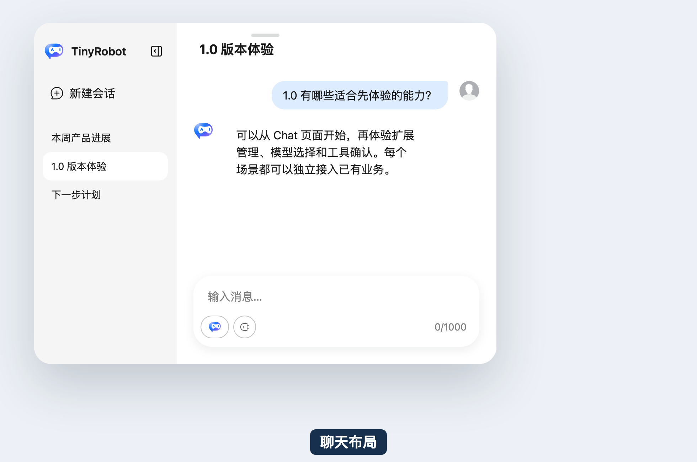
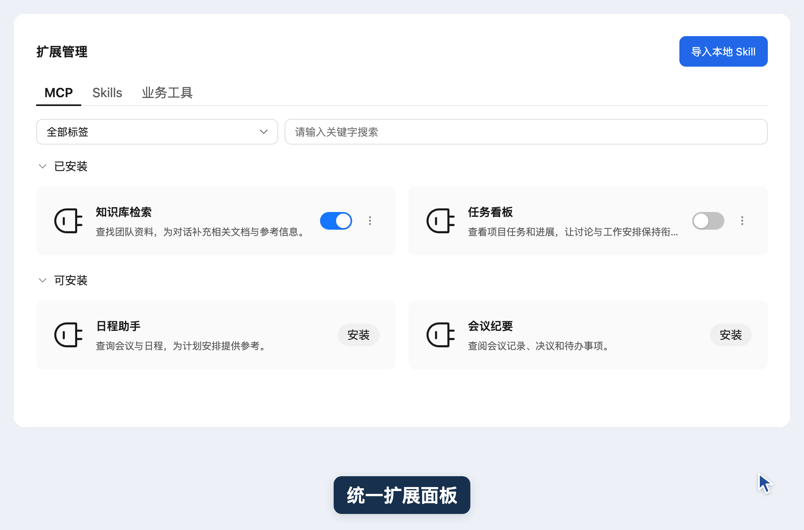
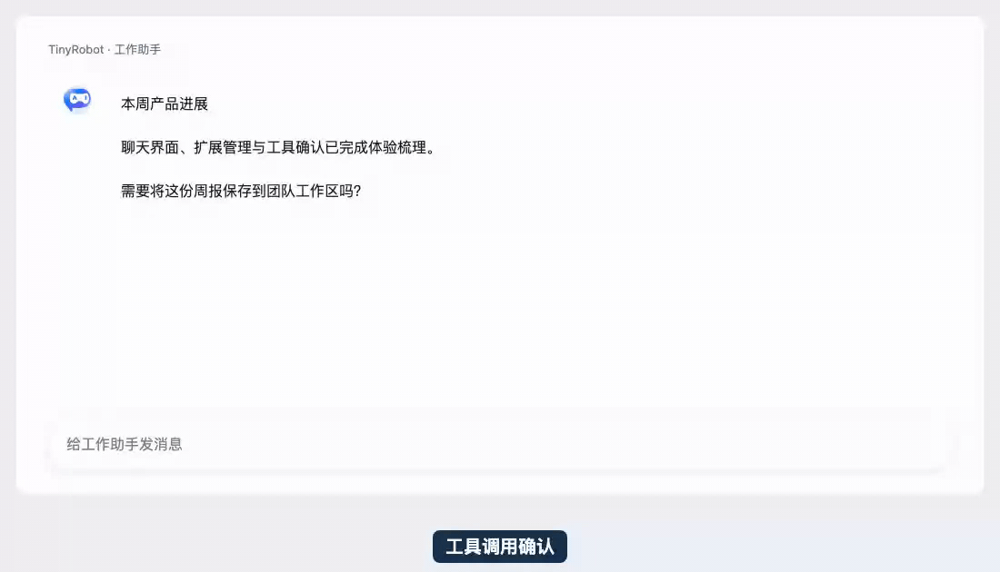

# TinyRobot 1.0：快速构建 AI 聊天应用

TinyRobot 是一套面向 Vue 应用的开源 AI 聊天框架。1.0 正式推出 `TrChat` 聊天套件，帮助你快速搭建独立聊天页，也能把 AI 助手嵌入现有业务。

## 新能力概览

- [TrChat 聊天套件](#trchat-聊天套件) 接入整套聊天功能，或在现有应用里只接入聊天界面。
- [模型选择](#模型选择) 搜索模型并在同一个面板里调整当前模型支持的设置。
- [统一扩展面板](#统一扩展面板) 在一处管理 MCP 服务、Skills 和应用自己的扩展。
- [工具调用确认](#工具调用确认) 在工具执行前决定是否允许，保存待确认状态后也可以刷新页面再继续。
- [多行输入首行提示](#多行输入首行提示) 在输入框首行显示自定义提示，切换任务时保留已输入的正文。

## TrChat 聊天套件

0.5 提供了会话列表、消息区和输入框等独立组件，`add chat` 模板也已引用实验版 `TrChat`。1.0 将 Chat 放到独立的 `@opentiny/tiny-robot-chat` 包中，提供正式版 `TrChat`、可独立使用的 `TrChatUI` 和管理会话与请求的 Runtime。

### 接入方式


**接入整套聊天功能。** 用 `useChatRuntime` 配置模型服务。

```vue
<TrChat :runtime="runtime" />
```

**只接入聊天界面。** 沿用应用已有的会话数据和发送逻辑。

```vue
<TrChatUI :data="chatData" @submit="handleSubmit" />
```

想快速试用，可以用 CLI 创建一个使用 `TrChat` 和 Runtime 的示例项目。

```bash
pnpm dlx @opentiny/tiny-robot-cli create my-chat
```

创建后按项目 README 配置模型服务。已有项目也可用 `add chat` 生成聊天模块，再将它挂载到页面。

手动接入时，在 Vue 3.3.11 或更高版本的项目中安装 Chat 和基础组件。

```bash
pnpm add @opentiny/tiny-robot-chat @opentiny/tiny-robot
```

将示例放进 `App.vue`，填入模型 ID 和浏览器可访问的接口地址。接口需兼容 OpenAI 的 `/chat/completions` 并支持流式响应。需要密钥时，可用后端转发地址，由服务端完成鉴权。

```vue
<script setup lang="ts">
import { TrChat, useChatRuntime } from '@opentiny/tiny-robot-chat'
import '@opentiny/tiny-robot/dist/style.css'
import '@opentiny/tiny-robot-chat/dist/style.css'

const runtime = useChatRuntime({
  modelProviders: [
    {
      type: 'openai',
      apiUrl: 'https://your-service.example.com/v1/chat/completions',
      models: [{ id: 'your-model-id', label: '应用助手' }],
    },
  ],
})
</script>

<template>
  <TrChat :runtime="runtime" />
</template>
```

已用 Kit 管理会话的应用，可通过 `useChatRuntimeFromConversation({ conversation })` 复用原有会话和请求配置。

接上 Runtime 后，用户可以切换会话、在原对话里追问，并看到回复逐步出现。应用也可以从输入区的拖放和粘贴事件取得文件，接入自己的附件上传和发送流程。



### 按业务场景配置界面

#### 长对话导航

在长对话里，点击消息目录中的一条提问，Chat 就会跳回那条消息。手动滚动对话时，目录也会高亮当前项。


0.5 提供了独立的 Anchor 组件。1.0 的 Chat 可通过 `ui.anchor` 从用户消息生成目录，默认在视口宽度达到 768px 时显示。

```vue
<TrChat :runtime="runtime" :ui="{ anchor: {} }" />
```

#### 聊天浮窗

完整的聊天页现在可以直接作为浮窗打开。1.0 把 0.5 的 Layout 浮窗能力接入了 Chat，拖动或缩放时，会话列表、消息区和输入框都随窗口一起移动或调整大小。



`TrChat` 和 `TrChatUI` 都通过 `ui.layout.surface` 配置显示方式。浮动窗口默认可拖动，设置 `resizable: true` 后还可以拉伸窗口边缘调整大小。

```vue
<TrChat
  :runtime="runtime"
  :ui="{ layout: { surface: { mode: 'floating', floatingOptions: { resizable: true } } } }"
/>
```

用 `ui.sender.toolbar` 还可以重排或隐藏模型选择和 MCP 入口，或添加应用自己的按钮。

## 模型选择

0.5 的 CLI 聊天模板已能切换模型、开启深度思考。1.0 的 `ModelSelector` 把模型和设置放进同一个面板，按当前模型展示支持的选项。用户可以按分组浏览，也可以直接搜索。


用 `group` 给模型分组，用 `features` 配置该模型支持的开关或选项。下面的示例在选中「推理助手」后保持面板打开，用户可以继续设置思考强度。应用提供的 `handleChange` 会收到当前的 `modelId` 和 `featureValues`。在 `TrChat` 中，Runtime 可按模型服务转换请求参数。

```vue
<script setup lang="ts">
const models: ModelSelectorOption[] = [
  { id: 'general', label: '通用助手', group: '通用模型' },
  {
    id: 'reasoner',
    label: '推理助手',
    group: '推理模型',
    features: [{
      key: 'reasoning',
      label: '思考强度',
      type: 'select',
      options: [{ value: 'balanced', label: '均衡' }, { value: 'deep', label: '深度' }],
    }],
  },
]
</script>

<template>
  <TrModelSelector
    default-value="general"
    :models="models"
    searchable
    :close-on-select="false"
    @change="handleChange"
  />
</template>
```

## 统一扩展面板

0.5 的 Kit 已支持在对话中使用 Skills。1.0 新增 `ExtensionManager`，把 MCP 服务、Skills 和应用自己的扩展放进同一个面板。



面板按安装状态分组，支持搜索和标签筛选。应用也可以通过 `ui.extensions.tabs` 在 Chat 右栏加入 Skills 或业务工具页。点击「安装」时，应用收到 `action` 事件，完成安装后更新条目。下面用「日程助手」模拟一次安装。

```vue
<script setup lang="ts">
const calendar = reactive<ExtensionManagerTab['items'][number]>({
  id: 'calendar',
  name: '日程助手',
  installed: false,
  actions: [{ id: 'install', type: 'button', label: '安装' }],
})
const tabs = [{ id: 'mcp', label: 'MCP', items: [calendar] }]

function handleAction({ action }: ExtensionManagerActionEvent) {
  if (action.id !== 'install') return
  calendar.installed = true
  calendar.actions = []
}
</script>

<template>
  <TrExtensionManager :tabs="tabs" @action="handleAction" />
</template>
```

## 工具调用确认

0.5 的 Kit 已能调用工具。1.0 允许应用指定哪些调用要在执行前暂停，让用户直接在对话卡片上选择「允许」或「拒绝」。应用保存待确认状态和会话消息后，用户刷新页面、重新打开原会话，仍可继续确认。



下面用 Kit 的 `shouldPauseToolCall` 设置暂停条件，再把卡片上的操作转成当前会话的命令。Kit 默认保存暂停的回合，示例用 `autoSaveMessages` 保存会话消息。应用提供 `responseProvider`、`getTools`、`callTool` 和 `needsApproval`，负责模型请求、工具执行和权限判断。

```vue
<script setup lang="ts">
const conversation = useConversation({
  storage: localStorageStrategyFactory({ key: 'chat-tool-approval' }),
  autoSaveMessages: true,
  useMessageOptions: {
    responseProvider,
    plugins: [toolPlugin({ getTools, callTool, shouldPauseToolCall: needsApproval })],
  },
})
const runtime = useChatRuntimeFromConversation({ conversation })

async function handleBubbleEvent({ name, payload }: ChatBubbleEventPayload) {
  if (name !== 'tool-call:resume' && name !== 'tool-call:reject') return
  if (!payload || typeof payload !== 'object' || !('toolCallId' in payload)) return
  const { toolCallId } = payload
  if (typeof toolCallId !== 'string' || !toolCallId) return

  const command = name === 'tool-call:resume' ? TOOL_RESUME_COMMAND : TOOL_REJECT_COMMAND
  await conversation.activeConversation.value?.engine.dispatchCommand(command, { toolCallId })
}
</script>

<template>
  <TrChat :runtime="runtime" @bubble-event="handleBubbleEvent" />
</template>
```

## 多行输入首行提示

1.0 的 Sender 新增 `input-prefix` 插槽，可在多行输入框的首行显示标签等自定义内容。切换任务时，应用可以更新首行标签，已输入的正文仍可接着编辑。


插槽只占首行空间，换行后正文从输入区左侧开始。下面的示例提交时会记录所选任务和正文。

```vue
<script setup lang="ts">
const labels = { reply: '客户回复', handoff: '交接摘要' }
type Task = keyof typeof labels
const task = ref<Task | null>(null)
const draft = ref('')
const submitted = ref<{ task: Task; text: string } | null>(null)

function submit(text: string) {
  if (!task.value) return
  submitted.value = { task: task.value, text }
  draft.value = ''
}
</script>

<template>
  <button type="button" @click="task = 'reply'">起草客户回复</button>
  <button type="button" @click="task = 'handoff'">生成交接摘要</button>
  <TrSender v-model="draft" mode="multiple" submit-type="ctrlEnter" :disabled="!task" @submit="submit">
    <template v-if="task" #input-prefix><span>{{ labels[task] }}</span></template>
  </TrSender>
  <p v-if="submitted">已提交 · {{ labels[submitted.task] }}</p>
</template>
```

## 其他改进与修复

### 新增能力

- **Sender** 支持通过 `appendTo` 指定模板下拉菜单的挂载容器，例如弹窗内的输入面板。 by @SonyLeo in [#394](https://github.com/opentiny/tiny-robot/pull/394)
- **TrChat** 支持应用回填提示词、清空输入文本或将焦点移到输入框。 by @SonyLeo in [#464](https://github.com/opentiny/tiny-robot/pull/464)
- **Kit** 支持用 `maxToolRounds` 限制一次用户提问可触发的工具调用批次。 by @gene9831 in [#406](https://github.com/opentiny/tiny-robot/pull/406)

### 问题修复

- **Sender** 修复中文输入法组合输入时丢字，以及同时启用模板和 @提及时丢失提及数据的问题。 by @SonyLeo in [#472](https://github.com/opentiny/tiny-robot/pull/472) [#482](https://github.com/opentiny/tiny-robot/pull/482)
- **TrChat** 修复只有附件的消息无法提交的问题。 by @SonyLeo in [#485](https://github.com/opentiny/tiny-robot/pull/485)
- **BubbleList** 修复启用自动滚动后，图片等内容延迟加载导致消息区没有继续跟随底部的问题。 by @gene9831 in [#421](https://github.com/opentiny/tiny-robot/pull/421)
- **Layout** 修复窄屏下抽屉侧栏被裁切的问题。 by @gene9831 in [#489](https://github.com/opentiny/tiny-robot/pull/489)

## 关于 TinyRobot

TinyRobot 是 OpenTiny 社区开源的 Vue 3 AI 组件库与应用开发套件，可用于构建智能对话应用和业务助手。

[TinyRobot 官网](https://docs.opentiny.design/tiny-robot)

欢迎在 GitHub 查看源码、反馈问题或提交改进。[TinyRobot 仓库](https://github.com/opentiny/tiny-robot) · [Issues](https://github.com/opentiny/tiny-robot/issues) · [Pull Requests](https://github.com/opentiny/tiny-robot/pulls) · [OpenTiny GitHub](https://github.com/opentiny)
