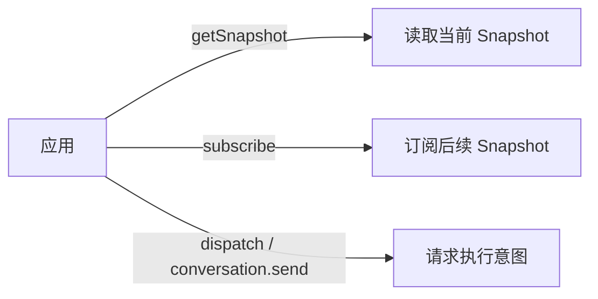
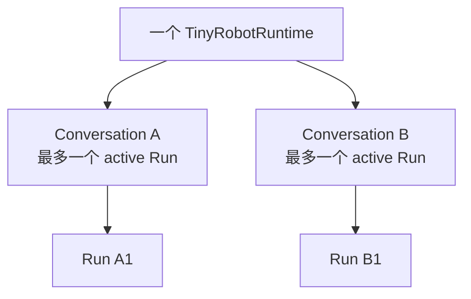

# Command 与 Runtime API

`TinyRobotRuntime` 是应用访问对话状态的公共根入口。应用可以创建 Conversation、读取当前状态、订阅变化并派发 Command，但不能直接改写对话数据。当前已实现的执行能力只有首个单 Step text/reasoning Run；停止生成、重试、恢复和工具流程尚未实现。

本文把“当前完整状态”称为 **Snapshot**，把“外部提出的请求”称为 **Command**。可以先通过 [快速开始](../guide/quick-start.md) 建立整体印象。

本页解决的问题是：应用怎样请求一次状态变化，同时仍让 Runtime 对校验、执行和最终状态负责。读完后，你应该能区分读取状态、订阅状态和提出请求这三种交互。

## 三种交互



### `getSnapshot()`

返回当前 Runtime 实例已知的完整 Snapshot。调用者可以读取，但不能原地修改。

### `subscribe(listener)`

监听以后发布的新 Snapshot。它不是 Provider stream 订阅，也不会把 raw chunk 暴露给 UI。

### `dispatch(command)`

接受 Runtime 的标准请求消息。Command 说明调用方希望 Runtime 对哪个领域对象执行什么动作，并携带完成该动作所需的领域输入。Runtime 根据 Command 的 `type` 校验请求，再把它路由到对应的执行流程。

例如 `SendCommand` 的职责是请求 Runtime：在指定 Conversation 中记录一次用户输入，并使用指定的 Provider 接入实例和模型创建新的 Turn 与 Run。

## Command、Domain Event 与 Snapshot

| 概念         | 例子                               | 含义                             |
| ------------ | ---------------------------------- | -------------------------------- |
| Command      | `send`、`abort`                    | 调用者的意图，可能被拒绝         |
| Domain Event | `run-created`、`text-part-delta`   | Runtime 内部已经确认发生的事实   |
| Snapshot     | 当前 Conversation、Run、Message 等 | reducer 归约后的唯一领域事实来源 |

UI 不应该自己根据 Provider stream 重放状态，也不应该把 Command 当作已经成功的结果。

## 先创建 Conversation

Conversation ID 由 Runtime 创建。返回的 `TinyRobotConversation` 只保存 ID 和 dispatcher 引用，不保存 Message、Run 或回答状态：

```ts
const conversation = runtime.createConversation()

await conversation.send({
  providerId: 'deepseek-compatible',
  modelId: 'deepseek-chat',
  content: '你好',
})
```

最终结果仍从 `runtime.getSnapshot()` 读取；facade 不是第二份状态源。

## `conversation.send()` 与 `dispatch(send)`

基础设施代码也可以直接派发完整 Command：

```ts
await runtime.dispatch({
  type: 'send',
  conversationId: conversation.id,
  providerId: 'deepseek-compatible',
  modelId: 'deepseek-chat',
  content: '你好',
})
```

两种写法走同一条执行路径：

```text
conversation.send(input)
→ dispatch({ type: 'send', conversationId, ...input })
→ run coordinator
→ LanguageModelV4.doStream()
→ Ingress Guard
→ Domain Events
→ reducer
→ Snapshot / subscribers
```

Runtime 直接调用 `LanguageModelV4.doStream()`，不使用 AI SDK Core `streamText()`，也不增加它的包装层。

| 输入                    | 职责                                                             | 消费者                         |
| ----------------------- | ---------------------------------------------------------------- | ------------------------------ |
| `SendCommand`           | 包含目标 Conversation、用户输入、`providerId` 和真实 `modelId`   | `dispatch()` 与 coordinator    |
| `ConversationSendInput` | 省略 facade 已绑定的 Conversation，携带 Provider、模型和用户文本 | `TinyRobotConversation.send()` |

当前 Send 输入不提供 reasoning 控制字段，Runtime 也不会在 call options 中注入默认值。模型采用具体 Provider 的默认行为；如果 Provider 返回标准 V4 reasoning part，Guard 会把它保存成独立的 `ReasoningPart`，而不是混入最终文本。

`conversation.send()` 只组装 `SendCommand` 后委托 `dispatch()`，没有第二套验证、模型选择或执行语义。

`RuntimeCommand` 使用普通数据表示，是为了让 `dispatch()` 接收的标准请求不依赖函数、模型实例或 Provider SDK 对象。这是 Command 边界的表示约束，不是 `SendCommand` 的业务职责。

应用通过 resolver 按 `providerId` 提供当前 registration，再由 Runtime 使用真实 `modelId` 选择模型。连接配置和 credential 由应用与 Provider 集成层管理，不进入 Command 或便利输入。Provider 配置可以在两次 Run 之间变化；已创建 Run 的标识和 capability metadata 保持冻结，但当前 Runtime 不用该 metadata gate 调用或入站内容。详细边界见 [Provider 注册与安全边界](./provider-registration.md)。

## 并发边界



“同一 Conversation 最多一个 active Run、不同 Conversation 可以并行”是 Runtime 契约边界。当前首个 text/reasoning 垂直切片尚未实现并发协调，调用方不能把这项后续能力当作现行行为。

## 失败意味着什么

当前 `dispatch(send)` 和 `conversation.send()` 返回的 Promise 会在本次文本 Run 终止后 settle。即便 Promise resolve，调用方仍应从 Snapshot 读取最终 Run、Message 和 Part，而不是维护第二份回答状态。

后续方法目前只稳定拒绝为 `runtime_operation_not_implemented`。本页不为 abort precedence、重试、恢复、工具执行或多 Step Run 承诺行为。

## 命名来源

Command 借鉴 CQRS 中“表达业务意图而不是直接设置字段”的含义，但 Tiny Robot 并未因此采用完整 CQRS 架构。参见 [Microsoft CQRS pattern](https://learn.microsoft.com/en-us/azure/architecture/patterns/cqrs) 和[命名来源与项目定义](../reference/terminology-sources.md)。

## 检查你的理解

1. 为什么 `TinyRobotConversation` 不保存 Message 或回答状态？
2. 为什么 `SendCommand` 和 `ConversationSendInput` 都不包含 credential？
3. `conversation.send()` 怎样保证与 `dispatch(send)` 只有一条执行路径？

下一步阅读 [Snapshot 与领域模型](./snapshot-and-domain-model.md)，理解应用最终读取的状态怎样组织。
