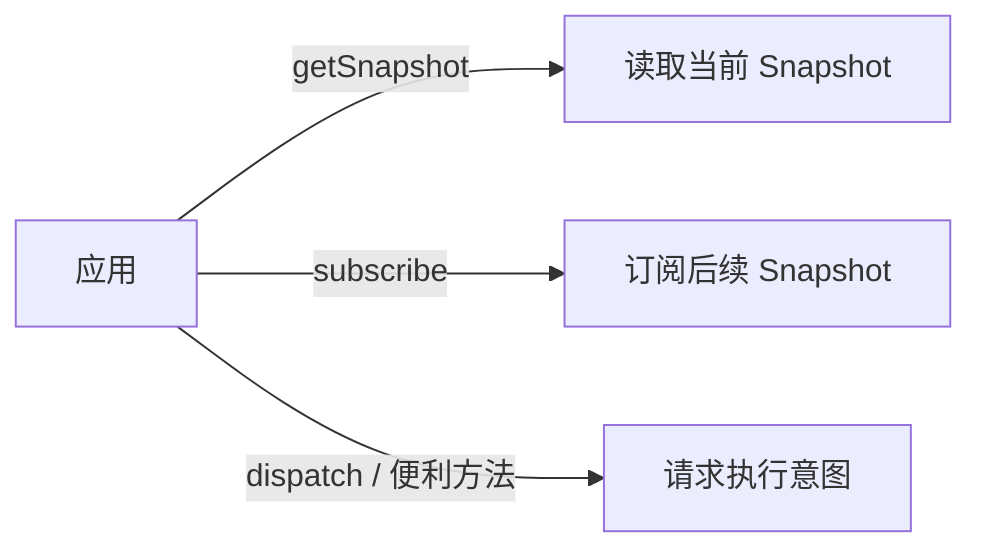
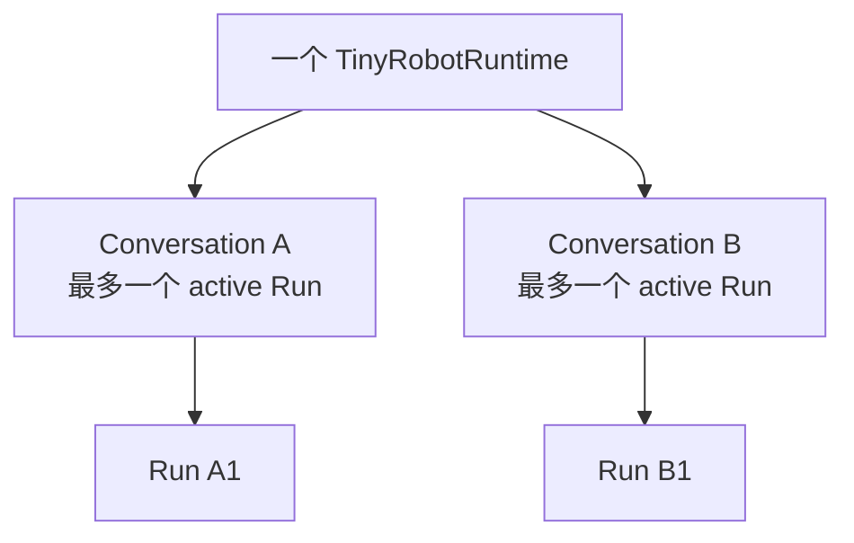

# Command 与 Runtime API

`TinyRobotRuntime` 是应用访问对话状态的唯一公共入口。应用可以读取当前状态、订阅变化，并提出“发送消息”或“停止生成”之类的请求，但不能直接改写对话数据。

本文把“当前完整状态”称为 **Snapshot**，把“外部提出的请求”称为 **Command**。可以先通过 [快速开始](../guide/quick-start.md) 建立整体印象。

本页解决的问题是：应用怎样请求一次状态变化，同时仍让 Runtime 对校验、执行和最终状态负责。读完后，你应该能区分读取状态、订阅状态和提出请求这三种交互。

## 三种交互



### `getSnapshot()`

返回当前 Runtime 实例已知的完整 Snapshot。调用者可以读取，但不能原地修改。

### `subscribe(listener)`

监听以后发布的新 Snapshot。它不是 Provider stream 订阅，也不会把 raw chunk 暴露给 UI。

### `dispatch(command)`

接受 Runtime 的标准请求消息。Command 说明调用方希望 Runtime 对哪个领域对象执行什么动作，并携带完成该动作所需的领域输入。Runtime 根据 Command 的 `type` 校验请求，再把它路由到对应的执行流程。

例如 `SendCommand` 的职责是请求 Runtime：在指定 Conversation 中记录一次用户输入，并使用指定的 Provider 接入实例和模型创建新的 Turn 与 Run。

## Command、Domain Event 与 Snapshot

| 概念         | 例子                               | 含义                             |
| ------------ | ---------------------------------- | -------------------------------- |
| Command      | `send`、`abort`                    | 调用者的意图，可能被拒绝         |
| Domain Event | `run-created`、`text-part-delta`   | Runtime 内部已经确认发生的事实   |
| Snapshot     | 当前 Conversation、Run、Message 等 | reducer 归约后的唯一领域事实来源 |

UI 不应该自己根据 Provider stream 重放状态，也不应该把 Command 当作已经成功的结果。

## Command 与便利输入

现行公共接口有两种发送方式：

```ts
await runtime.dispatch({
  type: 'send',
  conversationId: 'conversation-1',
  providerId: 'deepseek-compatible',
  modelId: 'deepseek-chat',
  content: '你好',
})
```

```ts
await runtime.send({
  conversationId: 'conversation-1',
  providerId: 'deepseek-compatible',
  modelId: 'deepseek-chat',
  content: '你好',
})
```

这两个入口服务于同一个发送行为，但输入职责不同：

| 输入          | 职责                                                            | 消费者                        |
| ------------- | --------------------------------------------------------------- | ----------------------------- |
| `SendCommand` | 描述用户输入，以及本次 Run 选择的 `providerId` 和真实 `modelId` | `dispatch()` 的校验和执行流程 |
| `SendInput`   | 为 `send()` 组合相同的领域字段                                  | `send()`                      |

两种入口具有相同的领域语义。`send()` 是 `dispatch()` 的便利入口，不形成第二套模型选择或认证协议。

`RuntimeCommand` 使用普通数据表示，是为了让 `dispatch()` 接收的标准请求不依赖函数、模型实例或 Provider SDK 对象。这是 Command 边界的表示约束，不是 `SendCommand` 的业务职责。

应用通过 resolver 按 `providerId` 提供当前 registration，再由 Runtime 使用真实 `modelId` 选择模型。连接配置和 credential 由应用与 Provider 集成层管理，不进入 Command 或便利输入。Provider 配置可以在两次 Run 之间变化，但已创建 Run 的标识和 capability 保持冻结。详细边界见 [Provider 注册与安全边界](./provider-registration.md)。

## 并发边界



同一 Conversation 首期最多只有一个 active Run；不同 Conversation 可以并行。这条规则属于 Runtime，不应由组件通过禁用按钮来“碰巧保证”。

## 失败意味着什么

`dispatch()` 和便利方法返回 Promise。Promise resolve 只表示请求已被 Runtime 接受并完成其约定阶段，不代表 Provider 一定成功回答；最终 Run 状态仍从 Snapshot 读取。

当前公共接口只承诺请求被接受或拒绝；具体执行协调、结果竞争和取消时序属于执行层。对应能力形成稳定公共行为后，Promise 的完成语义才能进一步收紧。

## 命名来源

Command 借鉴 CQRS 中“表达业务意图而不是直接设置字段”的含义，但 Tiny Robot 并未因此采用完整 CQRS 架构。参见 [Microsoft CQRS pattern](https://learn.microsoft.com/en-us/azure/architecture/patterns/cqrs) 和[命名来源与项目定义](../reference/terminology-sources.md)。

## 检查你的理解

1. 为什么 `dispatch()` 成功不等于模型回答成功？
2. 为什么 `SendCommand` 和 `SendInput` 都不包含 credential？
3. 同一 Conversation 的并发限制为什么由 Runtime 保证？

下一步阅读 [Snapshot 与领域模型](./snapshot-and-domain-model.md)，理解应用最终读取的状态怎样组织。
