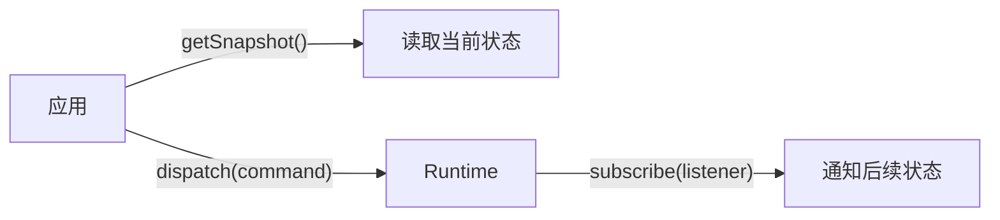
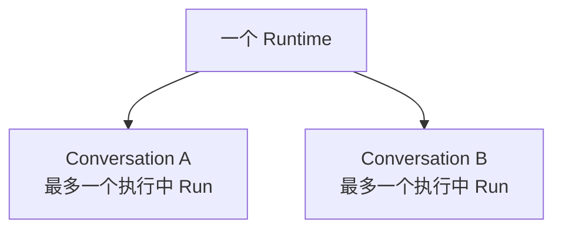

# 请求 Runtime 执行业务动作

本页面向已经完成[提交问题并读取回答](../guide/quick-start.md)和[应用与模型之间的运行边界](./runtime-overview.md)的读者。你应当已经知道 Snapshot 是 Runtime 当前状态，Command 是应用提交的业务请求。

`TinyRobotRuntime` 是应用访问对话能力的公共根入口。应用通过它读取状态、订阅变化或提出请求，但不能直接改写对话数据。本页说明这三种交互如何分工，以及 Conversation 便利对象怎样复用同一套 Command 语义。

## 读取、订阅与请求

Runtime 提供三类方向不同的交互：

- `getSnapshot()` 立即返回当前完整 Snapshot，供调用者只读查询；
- `subscribe(listener)` 注册监听器，在 Runtime 发布后续 Snapshot 时收到通知，并返回取消订阅函数；
- `dispatch(command)` 接收一个 Command，校验并执行其中表达的业务请求。



订阅通知仍然只提供 Snapshot，不暴露模型服务返回的原始数据。应用收到通知后，可以重新运行 Selector，读取自己关心的 Conversation。

## Command 表达意图而不是结果

Command 使用普通数据描述“调用方希望发生什么”。例如 `SendCommand` 请求 Runtime：在指定 Conversation 中记录用户输入，选择已配置的模型，并创建新的 Turn 和 Run。

Command 可能因输入无效、目标不存在或当前状态不允许而被拒绝，因此它不能充当成功结果。只有 Runtime 确认某件事已经发生后，才会形成 Domain Event；reducer 再根据这些事实计算下一份 Snapshot。

| 数据         | 表达的内容                     | 调用方怎样使用         |
| ------------ | ------------------------------ | ---------------------- |
| Command      | 希望 Runtime 执行的业务动作    | 通过 `dispatch()` 提交 |
| Domain Event | Runtime 内部已确认发生的事实   | 不由应用直接派发       |
| Snapshot     | Runtime 当前已经接受的业务状态 | 通过读取或订阅获得     |

## Conversation 便利对象

`runtime.createConversation()` 创建空 Conversation，并返回一个 `TinyRobotConversation`。这个返回对象只绑定 Conversation ID 和 Runtime 请求入口，不保存 Message、Run 或回答状态。

```ts
const conversation = runtime.createConversation()

await conversation.send({
  providerId: 'deepseek-compatible',
  modelId: 'deepseek-chat',
  content: '你好',
})
```

`conversation.send(input)` 会补上它已经绑定的 `conversationId`，再提交与下面等价的标准 Command：

```ts
await runtime.dispatch({
  type: 'send',
  conversationId: conversation.id,
  providerId: 'deepseek-compatible',
  modelId: 'deepseek-chat',
  content: '你好',
})
```

两种写法共用相同的校验、模型选择和执行过程。`conversation.send()` 不建立第二份状态；Promise 结束后，调用方仍从 Snapshot 查询最终 Run、Message 和 Part。

`ConversationSendInput` 是便利方法接收的输入，因此省略已经绑定的 `conversationId`；`SendCommand` 是 `dispatch()` 接收的完整请求，因此显式携带目标 Conversation。两者都只携带模型选择和用户文本，不携带模型实例、连接配置或认证凭据。

## 选择模型接入

发送请求中的 `providerId` 指向应用信任的一项模型接入配置，`modelId` 指向该接入公开的真实模型。Runtime 在 Run 开始时解析这项配置，并把当时选择的标识记录在 Run 中。

模型连接地址、请求头和凭据由应用及 Provider 集成管理，不能进入 Command 或 Snapshot。完整注册方式和安全边界在[注册可用的模型接入](./provider-registration.md)中解释。

当前 `send()` 不提供 reasoning 开关。模型是否产生 reasoning 由所选模型和接入能力决定；如果模型返回符合统一接口的 reasoning 内容，Runtime 会将它保存为独立 Part，而不是混入最终 text。

## 中止与其他请求

`runtime.abort(conversationId)` 请求停止指定 Conversation 当前正在执行的 Run。Promise 表示中止请求是否被 Runtime 接受；最终结果仍以 Snapshot 中 Run 的 `aborted` 状态和安全错误信息为准。

如果 Conversation 不存在或没有正在执行的 Run，中止请求会以稳定的 Runtime 错误码拒绝。用户主动中止与模型错误同时发生时，用户中止优先，Snapshot 只记录一个结束结果。

Runtime 接口还预留重试、重新生成和工具审批方法。当前阶段这些方法不会启动完整业务流程；调用方不能因为方法已经出现在类型中，就把对应能力视为可用。

## Conversation 之间的执行边界

一个 Conversation 同一时刻最多拥有一个正在执行的 Run；不同 Conversation 的 Run 可以各自推进。这项约束避免同一段对话中的两个回答同时争用相同上下文。



当前阶段尚未把所有并发拒绝、排队和恢复策略暴露为完整公共能力，因此应用不应自行推断未声明的协调结果。后续[同时管理多段对话](../examples/multiple-conversations.md)会从状态所有权角度验证不同 Conversation 的隔离。

下一步阅读 [Runtime 保存的对话状态](./snapshot-and-domain-model.md)，理解这些业务对象怎样组织成唯一、可查询的 Snapshot。
