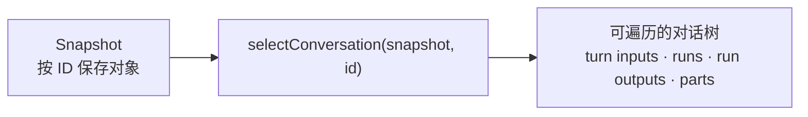

# 从状态中读取一段完整对话

<script setup>
import DomainSelectorDemo from './DomainSelectorDemo.vue'
</script>

本页面向已经理解 [Runtime 保存的对话状态](./snapshot-and-domain-model.md)的读者。你应当知道 Snapshot 按对象类型建立 ID 表，并用 ID 数组保存对象之间的关系。

页面如果每次都手动跨表查询，很容易重复关系查找和排序逻辑。**Domain Selector** 是只读查询函数：它接收 Snapshot 和一个领域对象 ID，从该对象开始展开相关记录，返回可直接遍历的领域树。它不修改 Snapshot，也不保存第二份状态。

## 从 ID 表到领域树

`selectConversation(snapshot, conversationId)` 接收完整 Snapshot 和 Conversation ID。对话存在时，它按照 Snapshot 中的 ID 顺序展开 Turn 输入、Run 输入引用、Run 输出、Step 与 Part；对话不存在时返回 `undefined`。



页面可以从最后一个 Turn 读取当前采用的回答：

```ts
import { selectConversation } from '@opentiny/tiny-robot-runtime/selectors'

const conversation = selectConversation(runtime.getSnapshot(), conversationId)
const turn = conversation?.turns.at(-1)
const answer = turn?.selectedRun

answer?.outputMessages.forEach((message) => {
  message.parts.forEach(renderPart)
})
```

查询结果仍然表达 Snapshot 中已有的领域关系：

- `turns`、`runs`、`inputMessages`、`outputMessages` 和 `parts` 保持对应 ID 数组的顺序；
- Turn 的 `inputMessages` 表示用户意图的归属，Run 的 `inputMessages` 表示执行引用，Run 的 `outputMessages` 表示本次尝试的产出；
- `activeRun` 是这段 Conversation 当前仍在执行的 Run；
- `selectedRun` 是同一 Turn 的多次尝试中当前被采用的 Run；
- 同一个 Run 被不同关系引用时，查询结果复用同一个对象，而不是复制新的领域实体。

## 区分不存在、空关系与损坏引用

查询根是调用方主动请求的 Conversation、Turn、Run 或 Message。查询根不存在时，Selector 返回 `undefined`，表示当前 Snapshot 没有这个对象。已有对象没有子项时，相关数组为空，这是合法状态。

如果查询根存在，但它的 ID 数组指向一个缺失对象，Snapshot 就违反了对象关系约束。Selector 此时抛出 `RuntimeSelectorError`；这是带有稳定错误字段的查询错误，用于暴露损坏的领域关系，而不是静默删除缺失分支。

| 情况                 | Selector 结果          | 业务含义                  |
| -------------------- | ---------------------- | ------------------------- |
| 查询根不存在         | `undefined`            | 当前 Snapshot 没有该对象  |
| 已有对象没有关联子项 | 空数组                 | 合法的空领域关系          |
| 已有对象指向缺失对象 | `RuntimeSelectorError` | Snapshot 的对象关系已损坏 |

下面的 Demo 直接调用公共 `selectConversation()`。默认样例会展开一棵完整领域树；切换另外两个样例，可以分别观察 `undefined` 和 `RuntimeSelectorError`。Demo 使用内置样例状态，可以跳过。

<ClientOnly>
  <DomainSelectorDemo />
</ClientOnly>

## 未变化的查询结果保持引用

Snapshot 更新时会复用未变化对象的引用。Selector 也缓存并复用未变化的查询分支：Conversation A 收到新的文本片段时，Conversation B 的查询结果仍可以保持同一个对象引用。

这个特性让 Vue 或 Angular 等界面适配层只响应实际变化的分支。Selector 本身不创建框架响应式对象，也不管理 DOM 状态。

组件通常还需要格式化时间、组合提示文案或加入折叠状态。把领域树进一步转换为组件输入的无副作用投影称为 **View Model**；负责这项转换的代码称为 **Presenter**。View Model 只为展示准备数据，不是新的持久化状态源。

输入框草稿、焦点、滚动位置和弹窗开关仍属于页面局部状态，不应混入 Selector 或 Snapshot。

下一步通过[同时管理多段对话](../examples/multiple-conversations.md)观察 Snapshot 的完整范围、页面选择状态和 Conversation 所有权怎样保持分离。
