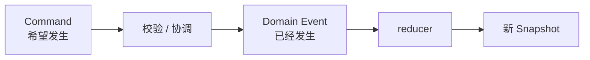
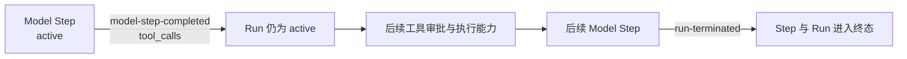
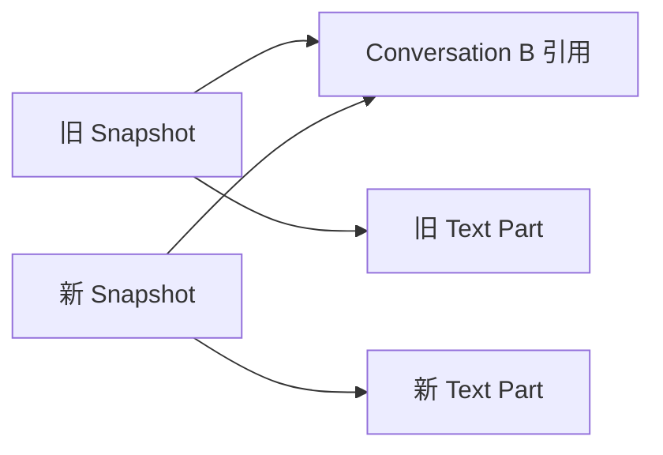

# 根据已确认事实更新状态

本页面向已经理解[应用与模型之间的运行边界](./runtime-overview.md)、[Runtime 保存的对话状态](./snapshot-and-domain-model.md)和[同时管理多段对话](../examples/multiple-conversations.md)的读者。Run、Model Step、text、reasoning 以及 Snapshot 对象关系沿用前述页面中的含义。

**Domain Event**（下文简称 Event）表示 Runtime 内部已经确认发生的事实，例如“回答已经开始”或“一段文字已经到达”。**reducer** 是更新状态的函数：它接收旧 Snapshot 和一个 Event，计算并返回新 Snapshot。

文档把这个计算过程称为“归约”。它只是更新状态，不表示压缩或删除数据。

本页解决的问题是：Runtime 怎样把“已经发生的事实”稳定地变成下一份 Snapshot。读完后，你应该能区分请求与事实，并判断哪些重复输入可以安全忽略、哪些输入会暴露对象关系错误。

```ts
reduceRuntimeEvent(snapshot, event): RuntimeSnapshot
```

reducer 必须是纯函数：不调用 Provider、不启动异步任务、不读取连接或认证配置、不修改旧 Snapshot，也不通知 UI。

Domain Event 借鉴领域驱动设计中“已经发生的领域事实”，reducer 借鉴单向状态管理中的纯状态计算。参见 [Microsoft Domain events](https://learn.microsoft.com/en-us/dotnet/architecture/microservices/microservice-ddd-cqrs-patterns/domain-events-design-implementation)、[Redux reducer 基础](https://redux.js.org/tutorials/fundamentals/part-3-state-actions-reducers) 和[命名来源与项目定义](../reference/terminology-sources.md)。

## Command 和 Event 不等价



例如 `abort` Command 只是“希望停止”的请求；只有执行层确认回答确实停止后，内部终止 Event 才能把 Run 状态更新为 `aborted`（已中止）。

## 当前 reducer 处理的事实

reducer 当前覆盖 Model Step 接收 text 或 reasoning 内容时的生命周期，以及一次回答结束时的稳定结果：

| Event                        | 对 Snapshot 的影响                                 |
| ---------------------------- | -------------------------------------------------- |
| `conversation-created`       | 创建 Conversation                                  |
| `turn-created`               | 创建 Turn，并追加到 Conversation                   |
| `turn-input-message-created` | 创建由 Turn 拥有的 user Message 和已完成 Text Part |
| `run-created`                | 创建 pending Run，冻结输入引用并设置 `activeRunId` |
| `step-started`               | 创建 Step，Run 进入 active                         |
| `run-output-message-created` | 创建由 Run 产生的输出 Message                      |
| `text-part-started`          | 创建 streaming Text Part                           |
| `text-part-delta`            | 按到达顺序原样追加文本                             |
| `text-part-ended`            | Text Part 进入 completed                           |
| `model-step-completed`       | Model Step completed，Run 保持 active              |
| `run-terminated`             | 当前实现同时终止 Step 与 Run                       |

这些是内部事件，不属于 Runtime 公共导出，也不能直接等同于 AI SDK stream part。

## 文本追加为什么不能“顺便整理”

文本 delta 必须按观察顺序精确追加：

```text
"第一行" + "\n" + "第二行"
=
"第一行\n第二行"
```

reducer 不得 trim、重新分词、合并空格或改变换行。空 delta 不产生实际变化，可以返回原 Snapshot 引用。

## 不变量错误与幂等

重复 Event 到达后不产生额外变化，这种性质称为**幂等**。当前处理规则是：

| 输入情况                                        | 结果                  |
| ----------------------------------------------- | --------------------- |
| 完全重复的创建或结束 Event                      | 幂等，返回原 Snapshot |
| 指向已经终止 Run 的迟到 Event                   | 不再改变 Snapshot     |
| 缺少被引用实体                                  | 抛出领域不变量错误    |
| Conversation/Turn/Run/Message/Part 所有权不一致 | 抛出领域不变量错误    |

`step-started` 不接收位置索引。reducer 按接受顺序把 Step ID 追加到 `Run.stepIds`；该数组是 Step 顺序的唯一来源。

用户输入在 `turn-input-message-created` 时一次性成为完整、已完成的领域内容。`run-created` 只冻结对这些 Message 的输入引用；后续 text/reasoning Part Event 只能更新对应 Run 自己产生的输出 Message，不能改写被引用的输入。

reducer 接收的是内部 Domain Event，因此所有权错误代表程序或适配代码缺陷，不应静默吞掉。模型返回的外部数据必须先经过响应检查关口，再转换成 Event；后续[校验模型返回的文本流](./model-step-ingress.md)把这个关口称为 Ingress Guard。

## Step 与 Run 为什么要分别终止

Step 终止表示“一次模型调用或工具执行已经结束”；Run 终止表示“针对这个 Turn 的整次回答尝试已经结束”。这是两个不同层级的事实。

调用模型的阶段是 Model Step；执行 Runtime 所管理工具的阶段称为 **Tool Step**。工具能力会把两类 Step 串联在同一个 Run 中，但当前页面只说明 reducer 能够表达的状态。

现行 `run-terminated` 同时接收 `stepId`、`stepStatus` 和 `runStatus`，用于最后一个 Model Step 与整个 Run 一起终止。模型也可能以 `tool-calls` 结束当前生成，表示它请求应用执行工具而不是继续输出文本。此时独立的 `model-step-completed` 会把当前 Model Step 写成 completed，同时让 Run 保持 active；它只表达模型调用已经结束，不执行工具。

多 Step Run 的事件顺序必须拆成：



- `model-step-completed` 结束当前模型调用，但不结束整个执行尝试；
- `run-terminated` 在当前实现中同时结束指定 Step 和整个执行尝试；
- 模型请求工具时，`Step（kind = 'model'）` 已结束，但 Run 仍是 active；
- 工具审批、Tool Step 创建和后续 Model Step 仍由后续工具流程补齐；
- 当前 abort 针对已经开始的 active Model Step，通过同一个 `run-terminated` 记录 `aborted`。

当前 reducer 已能表达“Model Step completed 而 Run active”，但尚不能自行推进工具审批、Tool Step 和后续模型调用。未来负责串联这些阶段的执行协调器会消费这个稳定状态继续 Run，而不是把 `tool-calls` 伪装成 completed Run。

## 结构共享示例

假设 Conversation A 收到一个文本 delta，而 Conversation B 没有变化：



新旧 Snapshot 可以共享 Conversation B；目标 Text Part 必须是新对象。永久回归测试应保护这种消费者可观察的不变量，而不是断言 reducer 内部调用顺序。

下一步阅读[注册可用的模型接入](./provider-registration.md)，理解 Runtime 在创建 Run 时怎样取得受信任的模型接入。
