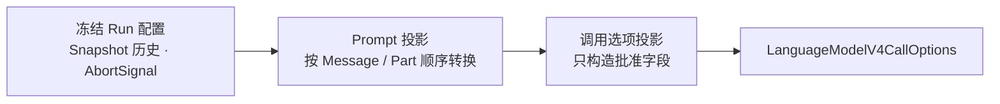

# 准备一次模型调用

<script setup>
import ModelCallProjectionDemo from './ModelCallProjectionDemo.vue'
</script>

本页面向已经理解[注册可用的模型接入](./provider-registration.md)和 [Runtime 保存的对话状态](./snapshot-and-domain-model.md)的 TypeScript 开发者。你应当知道 Registration 怎样创建统一模型对象，以及 Message 与 Part 怎样保存在 Snapshot 中。

模型调用中的 **prompt** 是发送给模型的有序消息历史；**call options** 是调用统一模型接口时传入的完整参数对象。Runtime 在调用模型前，需要把 Run 已经确定的输入引用、执行中产生的上下文和冻结配置转换成这两类输入。文档把这种只读取源数据并产生新对象的转换称为**投影（projection）**。

这项工作分成两个无副作用步骤：Prompt 投影生成模型可读的历史，调用选项投影生成最终 `LanguageModelV4CallOptions`。`LanguageModelV4CallOptions` 是固定 AI SDK 版本为 `LanguageModelV4.doStream()` 定义的输入类型。

这两个步骤的结果定义了模型调用边界接收的输入：一个只含批准字段的新对象。投影过程不创建模型、不发出请求，也不修改 Snapshot。

本页解决的问题是：Runtime 怎样把自己的领域状态安全、完整地转换为固定版本的模型调用对象。读完后，你应该能说明 Prompt 投影和调用选项投影为什么必须分开。

## 为什么调用前要分两步

调用方可以通过 `AbortSignal` 通知异步任务停止。Runtime 把当前 Run 的取消信号传给模型调用，使 `runtime.abort()` 能够终止正在等待的模型流；这个对象只用于执行期，不进入 Snapshot。



Prompt 投影回答“哪些已经完成的领域内容可以发送给模型”。调用选项投影把结果组合成固定字段集合，并确保调用方没有入口注入额外字段。

这里准备的调用用于文本生成。已经进入 Snapshot 的标准 reasoning Part 与 text Part 一样按历史顺序投影；具体 Provider 怎样转换 prompt 不属于 Runtime。输入边界只包含 Snapshot、Run ID、输出长度限制和 `AbortSignal`。当前 Send API 不表达 reasoning 控制，Runtime 不发送 `reasoning` call option。

## Prompt 怎样从 Snapshot 产生

`projectPrompt(snapshot, runId)` 先按顺序读取 `RuntimeRun.inputMessageIds`，再读取当前 Run 已经产生、可供后续 Model Step 使用的 `outputMessageIds`，最后按每个 `RuntimeMessage.partIds` 投影。输入引用不改变 Message 所有权；投影也不修改任何实体或数组。

| Runtime 历史                             | V4 结果                            |
| ---------------------------------------- | ---------------------------------- |
| system 的 completed text Parts           | 按顺序精确连接成 system `content`  |
| user 的 completed text Parts             | 保持 Part 顺序，生成 V4 text parts |
| assistant 的 completed text Parts        | 保持 Part 顺序，生成 V4 text parts |
| assistant 的 completed reasoning Part    | 保持 Part 顺序，生成 V4 reasoning  |
| streaming、unknown 或无法完整表达的 Part | 使用稳定 code 拒绝                 |

投影不 trim 文本、不改变换行、不补 Provider metadata。空字符串仍是合法文本；缺失内容和未完成内容则不是可回放历史。

## 正常场景

假设 Run 的历史依次包含 system text 和 user text。调用选项投影可以产生：

```ts
const options = buildModelCallOptions({
  snapshot,
  runId: 'run-1',
  maxOutputTokens: 512,
  abortSignal,
})

// 完整结果形状
const expected = {
  prompt: [
    { role: 'system', content: 'Answer briefly.' },
    { role: 'user', content: [{ type: 'text', text: 'Explain the boundary.' }] },
  ],
  maxOutputTokens: 512,
  abortSignal,
}
```

下面的 Demo 不直接调用内部投影函数，而是通过公共 `conversation.send()` 执行一次本地 Run，再由本地模型记录它实际收到的调用对象。默认结果只包含当前 Send 路径真正产生的 `prompt` 和 `abortSignal`；后者用可序列化的可用性标签展示。Demo 不访问网络，可以跳过并继续阅读类型边界。

<ClientOnly>
  <ModelCallProjectionDemo />
</ClientOnly>

`RuntimeModelCallOptions` 使用 `Pick` 和 `Required` 从固定版本的 `LanguageModelV4CallOptions` 派生批准字段。`ModelCallProjectionInput` 在这组字段上增加 Snapshot 和 Run ID，由投影生成 prompt；Provider 专属配置仍由 Provider 边界负责。以后增加经过批准的标准字段时，继续从固定 V4 类型派生，不重新声明字段类型。

## 边界场景

如果历史 Part 无法完整映射到批准的 prompt 形状，投影返回 `prompt_part_not_supported`。未完成、未知或角色不合法的 Part 也会使用对应的稳定 code 拒绝，不会产生删减后的 prompt。

投影采用**拒绝优先（fail closed）**策略：只要某段历史无法完整、安全地表达，就拒绝整次投影，而不是猜测或删减。它保护的是上下文语义，避免模型在调用方不知情时收到被悄悄改写的对话历史。

## 模型能力信息不改变本次调用

`RuntimeModelCapabilitiesV1` 来自 Registration 模型目录中的能力描述，并复制到 Run，供后续 UI 或能力设计使用。当前 Runtime 不根据这些信息拒绝 Provider 创建、模型调用或实际到达的标准 stream part。等产品需要显式开启、关闭或选择 reasoning 强度时，再设计可验证的控制能力；当前布尔值不表示模型默认行为，也不承诺怎样映射成服务商请求字段。

## 来源、依据与回归保护

`LanguageModelV4CallOptions` 与 prompt message 形状直接采用固定的 `@ai-sdk/provider@4.0.25` 类型；Tiny Robot 的允许字段和拒绝规则由项目契约定义。外部类型不会成为 Runtime Domain Model。

- 第一方来源：[AI SDK `LanguageModelV4CallOptions` 源码](https://github.com/vercel/ai/blob/main/packages/provider/src/language-model/v4/language-model-v4-call-options.ts)
- 正式设计依据：[LanguageModelV4 Boundary Contract v1](../design/language-model-v4-runtime-boundary-v1.md#4-capability-descriptor) · [ADR-0002：Provider 边界](../design/adr-0002-language-model-v4-provider-boundary.md)

以下永久测试保护这些行为：

- `test/prompt-projection.test.ts`：角色/Part 顺序、精确文本、reasoning 投影与拒绝优先规则；
- `test/model-call-projection.test.ts`：完整输入与输出字段集合、可选字段省略规则，以及模型能力信息不参与本次调用准入。

下一步阅读[校验模型返回的文本流](./model-step-ingress.md)，理解模型流怎样在进入 Runtime 领域状态前完成顺序、身份和安全校验。需要回看模型来源时进入[注册可用的模型接入](./provider-registration.md)；需要精确签名时进入 [Runtime API 与 TSDoc](../reference/runtime-api.md)；需要参与评审时使用[学习文档评审指南](../contributing/learning-document-review.md)。
