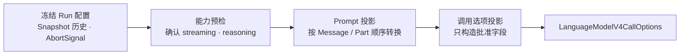

# 准备一次模型调用

Runtime 在调用模型前，需要把一次回答尝试（Run）中已经冻结的历史和配置转换成固定版本 AI SDK 接受的调用对象。这项工作分成三个无副作用步骤：能力预检（capability preflight）判断本次请求能否安全执行，prompt projection 生成模型可读的历史，model call options projection 生成最终 `LanguageModelV4CallOptions`。

这三个步骤的结果定义了模型调用边界接收的输入：一个只含批准字段的新对象。投影过程不创建模型、不发出请求，也不修改 Snapshot。

本页解决的问题是：Runtime 怎样把自己的领域状态安全、完整地转换为固定版本的模型调用对象。读完后，你应该能说明能力预检、Prompt 投影和调用选项投影为什么必须分开。

## 为什么调用前要分三步



能力预检回答“这个 Run 已冻结的模型能力能否满足本次请求”。Prompt 投影回答“哪些已经完成的领域内容可以发送给模型”。调用选项投影最后把两者组合起来，并确保调用方没有入口注入额外字段。

这里准备的调用用于文本生成，并可按 frozen Run 的 capability 请求 reasoning。已经进入 Snapshot 的标准 reasoning Part 与 text Part 一样按历史顺序投影；具体 Provider 怎样转换 prompt 不属于 Runtime capability。输入边界只包含 Snapshot、Run ID、输出长度限制、reasoning 级别和 `AbortSignal`。

## 能力预检

`RuntimeModelCapabilitiesV1` 是 Provider 注册维护者基于 conformance evidence 为单个模型提供、并在 Run 创建时冻结的声明。Runtime 使用它作调用决策，但不会把这项声明描述成 Runtime 独立验证过的服务能力。

能力预检检查：

- `streaming` 必须为 `true`；
- 调用包含 `reasoning` 时，`reasoning` capability 必须为 `true`。

失败以稳定 code 表示，例如 `model_streaming_unsupported` 或 `model_reasoning_unsupported`。Provider 原始错误文本、认证资料和原始响应不会成为错误内容。调用方明确请求 reasoning 而 capability 为 `false` 时，Runtime 拒绝调用，不会删除参数后继续执行。

boolean capability 只表达 Runtime 能否依赖标准 V4 行为。原生实现、兼容转换、具体协议字段和有损映射属于 Provider；相关证据由 conformance test、manifest 和支持文档承载，不进入 Snapshot。

当前 capability 不枚举模型接受的 reasoning 强度。Provider 负责把标准 `LanguageModelV4CallOptions.reasoning` 转换为具体请求，并明确处理不支持的取值。当 Runtime 需要在调用前展示模型可选强度时，可以把这一能力演进为 `ReadonlyArray<NonNullable<LanguageModelV4CallOptions['reasoning']>>`，由每个模型描述符提供自己接受的标准选项集合。

## Prompt 怎样从 Snapshot 产生

`projectPrompt(snapshot, runId)` 先读取 `RuntimeRun.messageIds`，再按每个 `RuntimeMessage.partIds` 的顺序投影。它只读取输入，不改变任何实体或数组。

| Runtime 历史                             | V4 结果                            |
| ---------------------------------------- | ---------------------------------- |
| system 的 completed text Parts           | 按顺序精确连接成 system `content`  |
| user 的 completed text Parts             | 保持 Part 顺序，生成 V4 text parts |
| assistant 的 completed text Parts        | 保持 Part 顺序，生成 V4 text parts |
| assistant 的 completed reasoning Part    | 保持 Part 顺序，生成 V4 reasoning  |
| streaming、unknown 或无法完整表达的 Part | 使用稳定 code 拒绝                 |

投影不 trim 文本、不改变换行、不补 Provider metadata。空字符串仍是合法文本；缺失内容和未完成内容则不是可回放历史。

## 正常场景

假设 Run 的历史依次包含 system text 和 user text，并为这次调用请求 `low` reasoning。调用选项投影可以产生：

```ts
const options = buildModelCallOptions({
  snapshot,
  runId: 'run-1',
  maxOutputTokens: 512,
  reasoning: 'low',
  abortSignal,
})

// 完整结果形状
const expected = {
  prompt: [
    { role: 'system', content: 'Answer briefly.' },
    { role: 'user', content: [{ type: 'text', text: 'Explain the boundary.' }] },
  ],
  maxOutputTokens: 512,
  reasoning: 'low',
  abortSignal,
}
```

`RuntimeModelCallOptions` 使用 `Pick` 和 `Required` 从固定版本的 `LanguageModelV4CallOptions` 派生批准字段。`ModelCallProjectionInput` 在这组字段上增加 Snapshot 和 Run ID，由投影生成 prompt；Provider 专属配置仍由 Provider 边界负责。以后增加经过批准的标准字段时，继续从固定 V4 类型派生，不重新声明字段类型。

## 边界场景

如果历史 Part 无法完整映射到批准的 prompt 形状，投影返回 `prompt_part_not_supported`。未完成、未知或角色不合法的 Part 也会使用对应的稳定 code 拒绝，不会产生删减后的 prompt。

这种 fail-closed 行为保护的是上下文语义：模型不能在调用方不知情时收到一段被悄悄删改的对话历史。

## 来源、依据与回归保护

`LanguageModelV4CallOptions` 与 prompt message 形状直接采用固定的 `@ai-sdk/provider@4.0.25` 类型；Tiny Robot 的允许字段和拒绝规则由项目契约定义。外部类型不会成为 Runtime Domain Model。

- 第一方来源：[AI SDK `LanguageModelV4CallOptions` 源码](https://github.com/vercel/ai/blob/main/packages/provider/src/language-model/v4/language-model-v4-call-options.ts)
- 正式设计依据：[LanguageModelV4 Boundary Contract v1](../design/language-model-v4-runtime-boundary-v1.md#4-capability-descriptor) · [ADR-0002：Provider 边界](../design/adr-0002-language-model-v4-provider-boundary.md)

以下永久测试保护这些行为：

- `test/prompt-projection.test.ts`：角色/Part 顺序、精确文本、reasoning 投影与 fail-closed rejection；
- `test/model-call-projection.test.ts`：streaming/reasoning capability、完整输入与输出 key 集合，以及可选字段省略规则。

## 检查你的理解

1. 为什么 capability 不负责描述 Provider 的原生或兼容实现方式？
2. 为什么未知或未完成的历史 Part 必须拒绝，而不能静默删除？
3. Provider 专属参数为什么不能通过调用选项投影进入 Runtime 公共协议？

下一步阅读[校验一次模型文本流](./model-step-ingress.md)，理解 constructed stream 怎样在进入 Domain 前完成顺序、身份和安全校验。需要回看模型来源时进入 [Provider 注册与安全边界](./provider-registration.md)；需要精确签名时进入 [Runtime API 与 TSDoc](../reference/runtime-api.md)；需要参与评审时使用[学习文档评审指南](../contributing/learning-document-review.md)。
