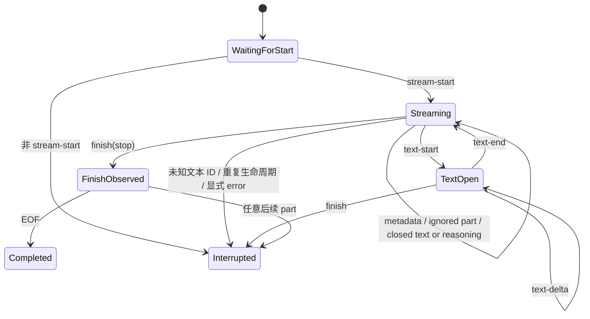

# 校验一次模型文本流

模型返回的流仍然是边界输入，不能直接成为 Runtime 状态。Ingress Guard（响应检查关口）负责读取一次 `Step（kind = 'model'）`（下文简称 Model Step）的 constructed `LanguageModelV4StreamPart` 流，校验文本与 reasoning 生命周期，并只把已经转换成 Runtime 身份的 Domain Event 交给 reducer。Model Step 与 Tool Step 只是同一 Step 实体的不同 kind。

本页解决的问题是：一组 Provider stream parts 怎样在不泄漏 Provider ID、metadata 或原始对象的前提下形成文本 Event。开始前应先理解[准备一次模型调用](./model-call-projection.md)和 [Domain Event 与 reducer](./events-and-reducer.md)。读完后，你应该能解释合法文本顺序、ID 转换和协议失败为什么只产生一个安全终态。

当前 coordinator 已能解析 Run-local registration、创建 V4 Provider 和 model，并直接调用一次 `doStream()`。它只把 `LanguageModelV4StreamResult.stream` 交给 Guard；`request`、`response`、headers、body 与其他调试数据在 coordinator 边界丢弃。Runtime 不使用 `streamText()`。

需要调试 Provider 输出时，应用可以配置 `inspect.streamPart`，在 Guard 投影前瞬时观察每个 V4 part 及其 Run、Step、Provider、model 上下文。观察器不能改变 part 或顺序，返回值会被忽略，同步异常也不会中断 Run。原 part 可能包含敏感 metadata 或 raw value；Runtime 不记录这些数据，应用应明确区分本地诊断与生产日志/上报，后两者必须先按 allowlist 脱敏。request 与 response 始终不可见。

现行能力处理首个单 Step constructed text/reasoning stream。工具组装与执行、file/source 展示、重试、恢复和多 Step continuation 尚未实现；超出当前投影子集的内容 part 会被忽略，不会被误解释成文本或写入 Snapshot。显式 Provider `error` 和结构性协议错误仍会产生稳定的 interrupted error。

## 正常场景

Coordinator 创建 Run、一个 `Step（kind = 'model'）` 和 assistant Message，并把 Runtime IDs、同步 Part ID 分配器、唯一的 `.stream` 与 `emit(event)` 交给 Guard。这里的 Model Step 精确表示一次 `LanguageModelV4.doStream()` 模型调用；它不表示 Message，也不拥有 Message。Provider 流按下面的顺序到达：

```text
stream-start
→ response-metadata
→ text-start(provider-text-a)
→ text-delta(provider-text-a, "第一行\n")
→ text-delta(provider-text-a, "第二行")
→ text-end(provider-text-a)
→ finish(stop)
→ EOF
```

Guard 在 `text-start` 时向 Runtime ID 分配器取得新的 `runtime-part-a`。Provider ID 只在当前 Step 的内存映射中关联这个 Runtime ID；之后发出的 Event 是：

```text
text-part-started(runtime-part-a)
→ text-part-delta(runtime-part-a, "第一行\n")
→ text-part-delta(runtime-part-a, "第二行")
→ text-part-ended(runtime-part-a)
→ run-terminated(completed, stop)
```

delta 按观察顺序原样发送，空格、空字符串和换行都不会被 trim 或重新分词。多个 Provider text ID 可以交错到达，每个 ID 都有自己的生命周期和 Runtime Part ID。

标准 `reasoning-start/delta/end` 使用相同的生命周期约束，但产生 `reasoning-part-*` Event 和 `RuntimePart.kind = 'reasoning'`。Reasoning 与 text 可以交错，各自拥有独立 Provider ID 映射；两类 Part 共用 Runtime ID 去重集合。Capability metadata 不参与入站判断：标准 V4 reasoning part 一旦实际出现，就是本次 Run 的事实。

## 状态机怎样阻止非法顺序



Guard 不在观察到 `finish` 时立即发出 completed terminal。它先等待 EOF；如果 finish 后还有任何 part，就改为一个 `interrupted` terminal。这样 reducer 不会先收到成功终态，再发现协议已经违反。

协议失败后 Guard 取消 reader，发出 exactly one `run-terminated(interrupted)`，再用稳定 code reject。错误不包含 Provider ID、delta、metadata、原始 finish reason、异常 message、stack 或 cause；terminal 后不再发出内容 Event。

## Metadata 与 usage 怎样停在边界内

`response-metadata` 不是领域事实。Guard 只在当前 Step 内规范化允许字段，用于检查重复值是否一致：

- response ID 和 model ID 必须是 1–128 个批准的 ASCII 字符；
- timestamp 必须能转换为 ECMAScript Date 范围内的整数 epoch milliseconds；
- 无效字段按 unavailable 处理；两个有效的同名字段不一致时中断。

这些值不会进入 Domain Event、Snapshot、返回结果或 Runtime 自身的日志与诊断。显式 inspector 可以在 Guard 前观察原 part，但不会改变投影结果。`providerMetadata`、warning 自由文本和 finish 的 raw reason 同样不会进入领域状态。

Usage 只保留 input、output、reasoning、cache read 和 cache write token。数值必须是从 0 到 `Number.MAX_SAFE_INTEGER` 的整数；合法的 0 保留，缺失或无效值保持 unavailable，`usage.raw` 始终丢弃。

## 两个关键边界场景

如果 `text-delta` 在对应 `text-start` 之前到达，Guard 返回稳定的 `model_step_text_id_unknown`。Provider ID 和 delta 内容不会出现在错误或终止 Event 中。

如果 `finish(stop)` 到达时仍有开放文本，Guard 返回 `model_step_text_open_at_finish`。这个 `Step（kind = 'model'）` 和 Run 被标记为 `interrupted`，不能伪装成 completed。

`raw`、custom、source、file、工具内容以及未来未知 part 在合法流期间都不形成 Event。它们被忽略只表示 Runtime v1 没有为其建立领域含义；并不表示这些能力可用。标准 reasoning 已建立领域投影；Provider 私有字段、signature、encrypted/redacted reasoning 和 `reasoning-file` 仍被丢弃。finish 后出现任何 part 仍违反 terminal silence。

## 来源、依据与回归保护

stream part、usage、finish reason 和 response metadata 的上游形状直接采用固定的 `@ai-sdk/provider@4.0.25`。合法顺序、身份转换和安全限制由 Tiny Robot 项目定义。

- 第一方来源：[AI SDK `LanguageModelV4StreamPart` 源码](https://github.com/vercel/ai/blob/main/packages/provider/src/language-model/v4/language-model-v4-stream-part.ts)
- 正式设计依据：[LanguageModelV4 Boundary Contract v1](../design/language-model-v4-runtime-boundary-v1.md#7-允许的-stream-parts) · [ADR-0002：Provider 边界](../design/adr-0002-language-model-v4-provider-boundary.md)
- 永久测试：`test/ingress-guard/text.test.ts` 保护 text/reasoning 合法映射、双 ID、metadata/usage allowlist 与 reducer 结果；`test/ingress-guard/order.test.ts` 保护两类内容的非法顺序、共享 Runtime ID、EOF、脱敏错误和 terminal silence。

## 检查你的理解

1. Provider text ID 为什么不能直接成为 `RuntimePart.id`？
2. 为什么 completed terminal 要等到 finish 后的 EOF 才发出？
3. metadata 已经通过字符限制后，为什么仍不进入 Snapshot？

当前学习路径已经覆盖模型调用前投影和 constructed text/reasoning stream 的入站校验。需要核对最终状态时回到[一次完成的文本回答](../examples/completed-text-run.md)；需要精确的规范性限制时查看 [LanguageModelV4 Boundary v1](../design/language-model-v4-runtime-boundary-v1.md)。
