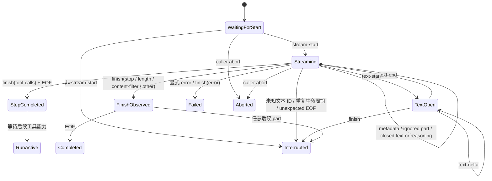

# 校验模型返回的文本流

本页面向已经理解[准备一次模型调用](./model-call-projection.md)和[根据已确认事实更新状态](./events-and-reducer.md)的读者。你应当知道 Model Step 是一次模型调用，Domain Event 是 Runtime 已确认的事实，reducer 根据 Event 计算新 Snapshot。

统一模型接口会异步返回一系列 `LanguageModelV4StreamPart`。每个 **stream part** 表示流中的一个结构化片段，例如文本开始、增量文本、文本结束或生成结束。它们是 Provider 集成已经从服务商协议转换出的统一接口数据，但仍然属于 Runtime 外部输入，不能直接成为领域状态。

文档把模型对象实际产生的这组 stream part 称为 **constructed stream**，用来区别服务商原始 HTTP 数据。**Ingress Guard** 是 Runtime 的响应检查关口：它读取 constructed stream，校验 text 与 reasoning 的生命周期和 ID，再把允许的内容转换成 Domain Event。Model Step 与 Tool Step 是同一种 Step 实体的两个类别，前者调用模型，后者执行 Runtime 管理的工具。

本页解决的问题是：一组 stream part 怎样在不泄漏 Provider 私有 ID、附加信息或原始对象的前提下形成安全 Event。读完后，你应该能解释合法文本顺序、ID 转换和协议失败为什么只产生一个结束结果。

负责串联一次 Run 执行步骤的代码称为**执行协调器**。它解析当前 Run 的 Registration，创建 Provider 与模型，并调用一次 `LanguageModelV4.doStream()`；返回结果中只有 `.stream` 会交给 Ingress Guard。请求、响应、请求头、响应体和其他调试数据在协调器边界被丢弃，Runtime 不使用更高层的 `streamText()` 包装。

应用可以配置 `inspect.streamPart` 作为临时**观察器**，在 Guard 转换前查看每个 stream part 及其 Run、Step、Provider 和模型上下文。观察器不能改变 part 或顺序，其返回值和异常不会影响 Run。原始 part 可能包含敏感附加信息，因此只能用于明确的诊断场景；生产日志和上报必须只保留经过允许列表筛选的字段。

现行能力处理一个 Model Step 中的 text 与 reasoning，并把用户取消、Provider 显式失败和协议中断分别记录为 `aborted`、`failed`、`interrupted`。工具输入组装与执行、文件或来源内容、重试、恢复和多 Step 延续尚未实现；没有建立领域含义的内容 part 会被忽略，不会被误解释成文本或写入 Snapshot。

## 正常场景

执行协调器创建 Run、一个 `Step（kind = 'model'）` 和 assistant Message，并把 Runtime ID 分配器、唯一的 `.stream` 与发送 Event 的函数交给 Guard。这里的 Model Step 精确表示一次 `LanguageModelV4.doStream()` 模型调用；它不表示 Message，也不拥有 Message。`EOF` 表示异步流已经自然结束。Provider 流按下面的顺序到达：

```text
stream-start
→ response-metadata
→ text-start(provider-text-a)
→ text-delta(provider-text-a, "第一行\n")
→ text-delta(provider-text-a, "第二行")
→ text-end(provider-text-a)
→ finish(stop)
→ EOF
```

Guard 在 `text-start` 时向 Runtime ID 分配器取得新的 `runtime-part-a`。Provider ID 只在当前 Step 的内存映射中关联这个 Runtime ID；之后发出的 Event 是：

```text
text-part-started(runtime-part-a)
→ text-part-delta(runtime-part-a, "第一行\n")
→ text-part-delta(runtime-part-a, "第二行")
→ text-part-ended(runtime-part-a)
→ run-terminated(completed, stop)
```

delta 按观察顺序原样发送，空格、空字符串和换行都不会被 trim 或重新分词。多个 Provider text ID 可以交错到达，每个 ID 都有自己的生命周期和 Runtime Part ID。

标准 `reasoning-start/delta/end` 使用相同的生命周期约束，但产生 `reasoning-part-*` Event 和 `RuntimePart.kind = 'reasoning'`。Reasoning 与 text 可以交错，各自拥有独立 Provider ID 映射；两类 Part 共用 Runtime ID 去重集合。Registration 声明的模型能力信息不参与入站判断：标准 V4 reasoning part 一旦实际出现，就是本次 Run 的事实。

## 状态机怎样阻止非法顺序



Guard 不在观察到 `finish` 时立即接受结束结果。它先确认所有 text 和 reasoning 内容段都已经关闭，再等待 EOF；如果 finish 后还有任何 part，就把结果改为 `interrupted`。这样 reducer 不会先收到成功事实，再发现协议已经违反。

用户中止的优先级最高，只产生一个 `run-terminated(aborted)`；显式 Provider error 产生 `failed`；执行异常、流意外结束和协议错误产生 `interrupted`。Guard 会停止读取流，并只暴露稳定的错误分类、错误码、是否可重试和合法 HTTP 状态码。错误不包含 Provider ID、增量内容、附加信息、原始结束原因、动态错误码、异常消息或调用栈；Run 结束后不再发出内容 Event。

Finish reason 的稳定映射是：`stop` → `completed/stop`，`length` → `completed/max_output_tokens`，`content-filter` → `completed/content_filter`，`error` → `failed`，`other` → `interrupted`。`tool-calls` 只产生 `model-step-completed(tool_calls)`：当前 Model Step completed，但 Run 保持 active，等待后续工具流程；这不表示工具组装或执行已经可用。

## 响应信息与 token 用量怎样停在边界内

`response-metadata` 是模型响应携带的描述信息，不是领域事实。Guard 只在当前 Step 内规范化允许字段，用于检查重复值是否一致：

- response ID 和 model ID 必须是 1–128 个批准的 ASCII 字符；
- timestamp 必须能转换为 ECMAScript Date 范围内的整数 epoch milliseconds；
- 无效字段按 unavailable 处理；两个有效的同名字段不一致时中断。

这些值不会进入 Domain Event、Snapshot、返回结果或 Runtime 自身的日志与诊断。显式 inspector 可以在 Guard 前观察原 part，但不会改变投影结果。`providerMetadata`、warning 自由文本和 finish 的 raw reason 同样不会进入领域状态。

**usage** 是模型报告的 token 用量。Runtime 只保留 input、output、reasoning、cache read 和 cache write 五类计数；数值必须是从 0 到 `Number.MAX_SAFE_INTEGER` 的整数。合法的 0 会保留，缺失或无效值继续表示“不可用”，原始 `usage.raw` 始终丢弃。

## 两个关键边界场景

如果 `text-delta` 在对应 `text-start` 之前到达，Guard 返回稳定的 `model_step_text_id_unknown`。Provider ID 和 delta 内容不会出现在错误或终止 Event 中。

如果 `finish(stop)` 到达时仍有开放文本，Guard 返回 `model_step_text_open_at_finish`。这个 `Step（kind = 'model'）` 和 Run 被标记为 `interrupted`，不能伪装成 completed。

原始、自定义、来源、文件、工具内容以及未来未知 part 在合法流期间都不形成 Event。它们被忽略只表示 Runtime v1 没有为其建立领域含义，并不表示这些能力可用。标准 reasoning 已建立领域投影；Provider 私有字段、签名、加密或脱敏 reasoning 和 `reasoning-file` 仍被丢弃。finish 后出现任何 part 仍违反“结束后不再输出内容”的规则。

## 来源、依据与回归保护

stream part、usage、finish reason 和 response metadata 的上游形状直接采用固定的 `@ai-sdk/provider@4.0.25`。合法顺序、身份转换和安全限制由 Tiny Robot 项目定义。

- 第一方来源：[AI SDK `LanguageModelV4StreamPart` 源码](https://github.com/vercel/ai/blob/main/packages/provider/src/language-model/v4/language-model-v4-stream-part.ts)
- 正式设计依据：[LanguageModelV4 Boundary Contract v1](../design/language-model-v4-runtime-boundary-v1.md#7-允许的-stream-parts) · [ADR-0002：Provider 边界](../design/adr-0002-language-model-v4-provider-boundary.md)
- 永久测试：`test/ingress-guard/text.test.ts` 保护 text/reasoning 合法映射、双 ID、响应信息与 usage 允许字段及 reducer 结果；`test/ingress-guard/order.test.ts` 保护两类内容的非法顺序、共享 Runtime ID、EOF、脱敏错误和结束后静默；`test/ingress-guard/terminal.test.ts` 与 `test/integration/abort-error.test.ts` 保护完整 finish 映射、usage 可用性、安全错误和用户中止竞争优先级。

当前学习路径已经覆盖模型调用前投影和 constructed text/reasoning stream 的入站校验。下一步进入[串联一次完整文本回答](../examples/completed-text-run.md)，把状态创建、模型调用、入站校验和最终 Snapshot 串成一条完整路径；需要精确的规范性限制时查看 [LanguageModelV4 Boundary v1](../design/language-model-v4-runtime-boundary-v1.md)。
