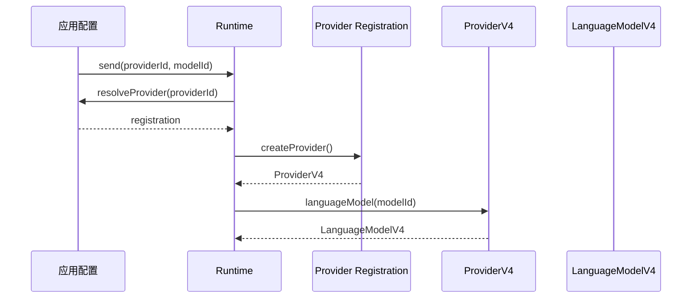
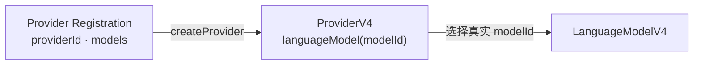
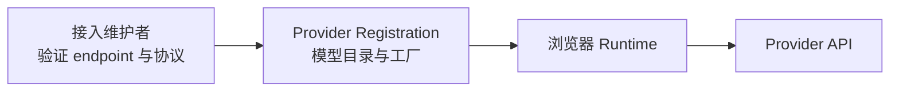
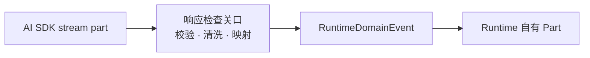

# Provider 注册与安全边界

应用可能同时接入官方模型服务、兼容接口和自己的私有 LLM API。应用先保存 Provider 连接配置，再由应用侧 Provider 集成代码直接复用对应的 AI SDK creator，构造 Runtime 可以解析的 Provider Registration。单纯转发 creator 配置不需要 Tiny Robot 再发布一个 Provider package。

这里的 `providerId` 是应用定义的接入实例标识，例如 `company-gateway` 或 `personal-openai`；它不要求等于厂商名称。每个模型使用 Provider 接受的真实 `modelId`。读完本页后，你应该能区分连接配置、Runtime registration 和 AI SDK Provider，并说明 credential 停在哪一层。

## 从一个自定义 Provider 开始

假设应用允许用户添加一个私有 LLM API。用户填写的是连接配置：

```ts
const config = {
  providerId: 'company-gateway',
  baseURL: 'https://llm.example.com/v1',
  headers: { 'X-Tenant': 'team-a' },
  models: {
    'chat-standard': {
      capabilities: { streaming: true, reasoning: false },
    },
    'chat-reasoning': {
      capabilities: { streaming: true, reasoning: true },
    },
  },
}
```

应用侧 Provider 集成代码把这份配置和应用拥有的 credential 交给具体 AI SDK creator，并返回 Runtime registration：

```ts
const registration = createOpenAICompatibleRegistration({
  ...config,
  apiKey,
})
```

`createOpenAICompatibleRegistration()` 内部复用 `createOpenAICompatible()`。Runtime 不需要理解 `baseURL`、headers、API key 或不同 Provider 的认证规则；registration 只暴露 `providerId`、模型目录和无参 `createProvider()`。

## 三层对象各自负责什么

| 对象                              | 负责什么                                            | 是否进入 Runtime 领域状态 |
| --------------------------------- | --------------------------------------------------- | ------------------------- |
| Provider Connection Configuration | endpoint、Provider 类型、设置和模型目录             | 否                        |
| Provider Registration             | 可信模型目录和已经绑定连接/认证行为的 Provider 工厂 | 否                        |
| AI SDK `ProviderV4`               | 按真实 `modelId` 创建模型并执行具体 Provider 协议   | 否                        |

应用负责 credential 的录入、保存、更新和删除；Provider 集成层与 AI SDK Provider 负责把 credential 转换为认证请求。Runtime 不接收、解释或转发 credential。

## 新 Run 怎样选择模型

应用拥有 Provider 配置，并向 Runtime 提供同步 resolver。每次开始新的回答尝试（Run）时，Runtime 使用 `providerId` 获取当时可用的注册，再用真实 `modelId` 选择模型。



应用可以在 Runtime 创建后增加、更新或移除自己的 Provider 配置。resolver 在新的 Run 开始时读取当前配置，因此后续 Run 可以使用新加入的 Provider；已经创建的 Run 继续使用创建时冻结的 `providerId`、`modelId` 和 capability metadata。

当前执行协调层已经把 resolver、Run-local Provider/model 创建和首个单 Step text/reasoning Run 串联起来。`conversation.send()` 或等价的 `dispatch(send)` 会通过这里描述的 registration 实际调用一次 `LanguageModelV4.doStream()`；工具循环、重试、恢复和多 Step 仍属于后续能力。

## ProviderV4 是复用的模型选择接口

注册的无参 `createProvider()` 返回 Tiny Robot 使用的 AI SDK `ProviderV4` 子集。Runtime 随后调用 `languageModel(modelId)` 得到 `LanguageModelV4`。因此连接和认证由 Provider 集成层完成，模型查找和模型对象创建沿用 AI SDK 的 Provider 抽象；Tiny Robot 只增加应用接入实例、模型能力与安全生命周期所需的边界。



`models` 是注册维护者评审过的目录，不是对 Provider 的模型列表做运行时猜测。请求的 `modelId` 必须同时存在于该目录并能由 `languageModel()` 解析。

## credential 属于应用与 Provider

credential 不属于 Runtime 的一次 Send 或 Run 输入。应用可以在用户更新连接配置时替换 registration，也可以让 Provider 集成层的工厂读取应用当前拥有的 credential；两种方式都由应用和 Provider 集成层决定。

Runtime 的 Command、便利方法、resolver 和 `createProvider()` 都不接收 credential。Runtime 只持有当前 Run 所需的 Provider 与模型引用，并在 Run 终止后释放这些执行引用。credential 不进入 Domain Event、Snapshot、日志、fixture、错误上报或 Runtime UI API。

## 浏览器直连的责任

Runtime v1 在浏览器中直接请求 Provider API。注册维护者负责验证目标 endpoint 的 CORS、认证、流式响应和模型映射，并用 conformance test、live verification 清单和支持文档记录证据。



自定义或 OpenAI-compatible endpoint 承担同样的验证责任。Runtime 只消费应用解析出的受信任注册。Task 5 已能安全处理中途出现的标准 V4 `error` part 和协议错误，但 `doStream()` 直接抛出的 Provider/transport error 尚未归一化为完整 Run 终态；该能力属于 Task 6。

## capability 当前作为模型 metadata

`RuntimeModelCapabilitiesV1` 属于模型描述符，而不是整个 Provider。当前 `streaming` 和 `reasoning` 仍随 descriptor 复制到 Run，但 Task 5 不用它们拒绝 factory、模型调用或合法的标准 V4 stream part。

这些字段暂时只为后续 UI 与能力设计保留，不表达 reasoning 默认开启或关闭，也不证明某个控制值能映射到 wire request。当前 Send 不提供 reasoning 控制；当 Runtime 需要显式控制时，再基于 conformance evidence 演进 descriptor。

## 为什么 Runtime Part 保持自有类型

Provider 与模型选择接口可以直接复用 `ProviderV4` 和 `LanguageModelV4`，但进入 Snapshot 的 Message/Part 有另一套职责：它们必须表达 Runtime 已接受、可持久化的领域事实。



显式转换阻止上游联合类型的新增成员自动进入 Runtime 公共契约。Provider/Ingress conformance 测试负责发现上游差异，Runtime 公共类型和 reducer 测试负责保护稳定的领域语义。

## 检查你的理解

1. Provider Connection Configuration 与 Provider Registration 分别由谁拥有？
2. 为什么 Runtime 不接收 `baseURL`、headers 或 credential？
3. 新增 Provider 配置为什么只影响后续 Run？
4. Provider 接口可以复用 AI SDK，Runtime Part 为什么仍保持自有类型？

下一步阅读[准备一次模型调用](./model-call-projection.md)，理解 Runtime 怎样使用 Run 历史构造调用对象，以及为什么当前 capability 只作为冻结 metadata。设计依据见 [ADR-0005：Provider 注册与运行时解析](../design/adr-0005-provider-registration-and-runtime-resolution.md)和 [LanguageModelV4 Boundary Contract v1](../design/language-model-v4-runtime-boundary-v1.md)。
