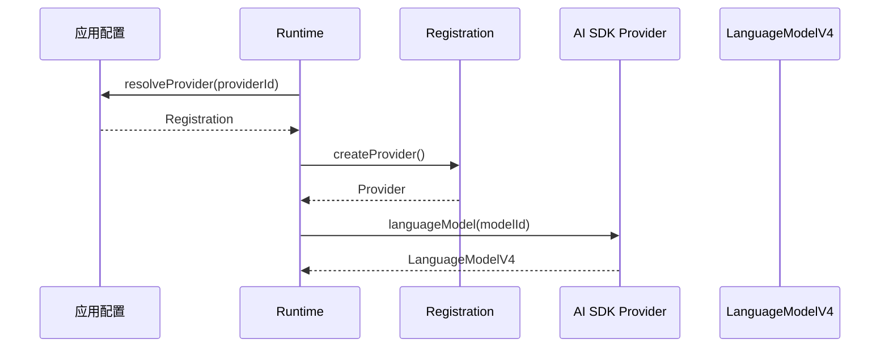
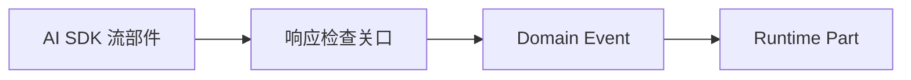

# 注册可用的模型接入

本页面向已经理解[应用与模型之间的运行边界](./runtime-overview.md)、[请求 Runtime 执行业务动作](./commands-and-runtime.md)和[根据已确认事实更新状态](./events-and-reducer.md)的应用集成者。你应当知道：`providerId` 与 `modelId` 用于选择模型，模型服务原始响应不能直接进入 Snapshot。

应用可能同时连接官方模型服务、兼容接口和私有大语言模型（LLM）API。这里要解决的问题是：怎样把一项由应用管理的连接安全地提供给 Runtime，同时让地址、请求头和凭据停留在接入层。

## 三种对象

模型接入涉及三种职责不同的对象：

1. **连接配置**由应用保存，包含服务地址、服务类型、认证设置和允许使用的模型目录。
2. **Provider Registration** 是应用交给 Runtime 的受信任注册项，包含稳定 `providerId`、模型目录和创建 Provider 的工厂；下文简称 Registration。
3. **AI SDK Provider** 是实现具体服务协议的模型选择接口。Runtime 向它传入真实 `modelId`，获得统一的 `LanguageModelV4` 模型对象。

`LanguageModelV4` 已在运行边界页中定义为 Runtime 采用的统一语言模型接口。凭据（credential）是 API key、访问令牌等认证材料，只属于应用和 Provider 集成，不属于 Registration 的公共标识或 Runtime 领域状态。

| 对象                  | 负责内容                                       | 是否进入 Snapshot |
| --------------------- | ---------------------------------------------- | ----------------- |
| 连接配置              | 服务地址、认证设置、模型目录                   | 否                |
| Provider Registration | 可信模型目录和已经绑定连接行为的 Provider 工厂 | 否                |
| AI SDK Provider       | 根据真实 `modelId` 创建模型并执行具体服务协议  | 否                |

## 从私有模型服务创建 Registration

假设应用允许用户添加一项私有 LLM API。连接配置先由应用保存：

每个模型条目包含一份 **capability metadata**，也就是接入维护者声明的模型能力信息。`streaming` 表示该映射能够完成 Runtime 所需的流式调用；`reasoning` 记录模型是否声明推理能力。当前这些布尔值只随 Run 保存，不能证明某个请求开关已经启用，也不阻止实际到达的标准 reasoning Part。

```ts
const config = {
  providerId: 'company-gateway',
  baseURL: 'https://llm.example.com/v1',
  headers: { 'X-Tenant': 'team-a' },
  models: {
    'chat-standard': {
      capabilities: { streaming: true, reasoning: false },
    },
    'chat-reasoning': {
      capabilities: { streaming: true, reasoning: true },
    },
  },
}
```

应用侧 Provider 集成把连接配置和应用拥有的凭据交给具体 AI SDK 创建函数，再返回 Registration：

```ts
const registration = createOpenAICompatibleRegistration({
  ...config,
  apiKey,
})
```

示例创建函数内部可以复用 AI SDK 的 `createOpenAICompatible()`。Runtime 不需要理解 `baseURL`、请求头、API key 或服务商认证规则；Registration 只暴露 `providerId`、模型目录和无参 `createProvider()`。

## 每个 Run 在开始时解析接入

应用在创建 Runtime 时提供 `resolveProvider(providerId)`。这个同步查询函数称为 **resolver**：每当一个新 Run 开始，它根据 `providerId` 返回当时有效的 Registration；找不到时返回 `undefined`，Runtime 会在创建模型前拒绝请求。



resolver 每次在新 Run 开始时读取当前配置，所以应用可以在两个 Run 之间增加、更新或移除接入。已经开始的 Run 继续使用开始时解析出的 Provider，并把当时选择的 `providerId`、`modelId` 和模型能力信息冻结在自己的状态中。

Registration 的模型目录是接入维护者已经评审的允许列表。请求的 `modelId` 必须同时存在于该目录，并且能够由 Provider 的 `languageModel(modelId)` 创建；Runtime 不猜测服务商还支持哪些模型。

## 凭据和原始数据停在接入层

Runtime 的 Command、Conversation 便利方法和 Snapshot 都不接收凭据。Provider 集成可以把凭据绑定在 `createProvider()` 的闭包中，也可以在创建新 Provider 时从应用配置读取当前值；无论采用哪种方式，凭据都不能进入 Domain Event、Snapshot、日志、测试样例、错误上报或 URL。

Runtime 只在当前 Run 执行期间持有 Provider 和模型引用。模型返回的流还必须经过后续响应检查，才能转换成 Runtime Part；服务商原始 payload、私有 metadata 和动态错误文本不会因为 Provider 已受信任就自动进入领域状态。

## 浏览器直连需要实际验证

当前 Runtime 在浏览器中直接请求模型服务。接入维护者必须验证：目标地址允许当前网页跨域访问，认证方式适用于浏览器，流式响应能够被所选 AI SDK Provider 正确解析，模型目录中的每个 ID 都能创建预期模型。

自动一致性测试可以检查 Registration 的固定形状和映射；真实浏览器验证负责证明实际地址、认证和流式协议在当前版本组合下可用。一次成功请求不能自动成为所有版本和环境的长期支持声明。

进入 Snapshot 的 Message 和 Part 仍使用 Runtime 自有类型。显式转换可以阻止 AI SDK 后续新增的流部件自动扩大 Runtime 公共契约：



下一步阅读[准备一次模型调用](./model-call-projection.md)，理解 Runtime 怎样从 Snapshot 生成统一模型接口允许的调用对象。设计依据见 [ADR-0005：Provider 注册与运行时解析](../design/adr-0005-provider-registration-and-runtime-resolution.md)和 [LanguageModelV4 Boundary Contract v1](../design/language-model-v4-runtime-boundary-v1.md)。
