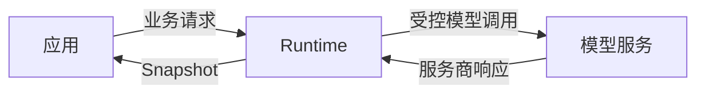
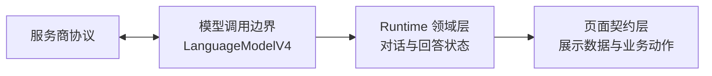
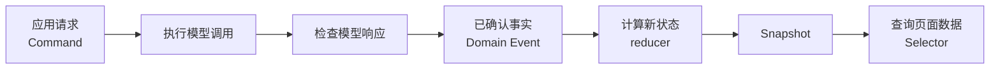

# 应用与模型之间的运行边界

本页面向已经完成[提交问题并读取回答](../guide/quick-start.md)的读者。你应当已经知道：Runtime 接收应用请求，Run 表示一次回答尝试，Snapshot 保存页面读取的对话状态。

这里继续解决一个问题：应用、Runtime、模型接入代码和页面都参与一次问答时，各自的责任停在哪里。读完后，你应该能够解释为什么模型返回的数据不能直接成为页面状态。

## 三个参与方

一次最小问答涉及三个参与方：

- **应用**决定用户要做什么、允许使用哪些模型接入，并向 Runtime 发出请求；
- **模型服务**接收模型调用并流式返回内容，具体 HTTP 格式可能因服务商而异；
- **Runtime**位于两者之间，把应用请求转换为受控模型调用，检查模型结果，再发布新的 Snapshot。

模型服务的协议发生变化时，应用的对话状态不应该被迫一起变化；页面框架发生变化时，也不应该重新实现模型响应校验。这正是 Runtime 边界存在的原因。

## 四层职责

不同模型服务的协议需要先由一段适配代码转换成 Runtime 允许调用的统一接口。文档把这段适配代码称为 **Provider 集成**。当前统一接口采用 `LanguageModelV4`：它是 AI SDK 提供的第四版语言模型接口规范，让 Runtime 可以用同一种调用形状连接不同服务商。

为了把变化限制在负责它的地方，系统进一步区分四层：

1. **服务商协议**是模型服务真实使用的 HTTP 请求和响应格式。
2. **模型调用边界**是 Runtime 允许使用的统一模型接口，由 Provider 集成把服务商协议适配到这里。
3. **Runtime 领域层**保存 Conversation、Run 和 Snapshot 等业务对象及其约束。
4. **页面契约层**把 Snapshot 中的领域对象转换为组件需要的数据，并把用户操作表达为业务动作。

Provider 集成掌握连接地址和认证方式，但不能把服务商原始数据直接写进 Snapshot。**页面契约**只负责读取和表达交互，不负责调用模型或修改 Runtime 状态。

例如，AI SDK 新增一种流式数据，并不意味着这种数据自动成为可持久化的 Runtime 状态。Provider 集成可以接收到它，但只有经过 Runtime 明确检查和转换的业务信息才能进入 Snapshot。

## 状态变化的三个阶段

Runtime 使用三个不同概念分开“请求做什么”“已经发生什么”和“页面读取什么”：

- **Command** 是应用提交给 Runtime 的业务请求，例如发送一条用户消息；
- **Domain Event** 是 Runtime 检查输入后确认已经发生的业务事实，例如回答开始或文本已经追加；
- **Selector** 是只读查询函数，从完整 Snapshot 中选取并组合页面需要的领域对象。

确认 Domain Event 后，Runtime 使用一个称为 **reducer** 的纯计算函数，根据旧 Snapshot 和 Event 产生新 Snapshot。这个更新过程称为归约。reducer 不调用模型，也不操作页面。

这条链路建立了一个关键约束：模型原始响应不能直接修改 Snapshot。它必须先通过 Runtime 的检查，再转换成 Domain Event；reducer 只处理已经进入领域边界的事实。

## Snapshot 与页面局部状态

Snapshot 保存跨页面和框架都需要一致理解的对话事实，例如：

- Conversation 中 Turn 的顺序；
- 当前仍在执行的 Run；
- 当前被采用的回答；
- Message 与 Part 的顺序；
- Run 是执行中、正常完成还是异常结束。

页面自身的交互细节通常不属于 Runtime 领域状态，例如：

- 当前选中的侧边栏项目；
- 输入框草稿；
- 焦点、滚动位置和弹窗开关；
- 只用于动画的瞬时标记。

因此，Selector 可以根据 Snapshot 准备展示数据，但不会把页面草稿或 DOM 状态写回 Runtime。

## 当前学习范围

当前实现已经支持：应用发送文本问题；Runtime 选择已注册模型并执行一次模型调用；模型流经过检查后形成 text 或 reasoning Part；Run 以完成、模型失败、用户中止或协议中断等结果结束。

这里的 text 和 reasoning 沿用快速开始中的含义：text 是最终回答，reasoning 是部分模型提供的独立中间推理内容。当前一次 `send()` 只执行一个 Model Step。工具执行、持久化恢复和更复杂的多 Step 流程属于后续能力，不能当作现行 API 使用。

下一步阅读[请求 Runtime 执行业务动作](./commands-and-runtime.md)，了解应用可以发送哪些 Command，以及 Conversation 便利对象与底层 Runtime API 怎样分工。需要核对完整分层和长期约束时，再进入[下一代架构总览](../design/architecture-overview.md)。
