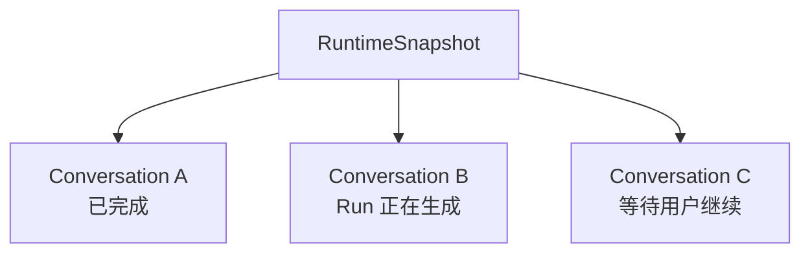
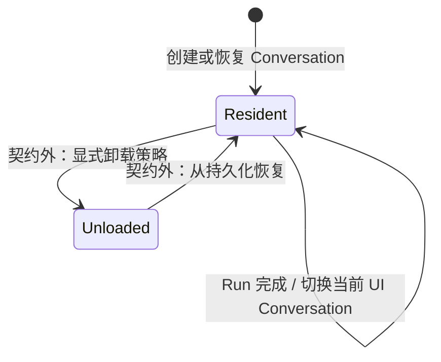

# Snapshot 与领域模型

本页面向已经完成[提交问题并读取回答](../guide/quick-start.md)、[应用与模型之间的运行边界](./runtime-overview.md)和[请求 Runtime 执行业务动作](./commands-and-runtime.md)的读者。Conversation、Turn、Run、Step、Message 与 Part 沿用前述页面中的含义。

可以把 Snapshot 理解为 Runtime 当前内存中的“状态总账”：页面想知道有哪些对话、问题和回答，都从这里读取。它不是后端数据库，也不一定包含用户历史上的所有对话。

为了让每个业务对象只保存一份，Snapshot 按对象类型建立 ID 表，再用 ID 记录对象关系。这种组织方式称为**规范化状态**。`RuntimeSnapshot` 是**一个 `TinyRobotRuntime` 实例当前已知并驻留在内存中的完整、规范化领域状态**。

本页解决的问题是：一次问答涉及多个对象时，Runtime 怎样保存唯一、可查询且不会互相覆盖的领域状态。读完后，你应该能沿着 ID 从 Conversation 找到最终 Part，并说明 Snapshot 不等于后端数据库或 UI state。

这一定义同时限定了三个范围：

- 它属于一个 Runtime 实例，不是全局单例；
- 它可以包含多个 Conversation，不是某一个 Conversation 的局部状态；
- 它只表示当前驻留数据，不等于持久化存储中的全部历史。

## Snapshot 的职责

`RuntimeSnapshot` 负责：

1. 保存 Runtime 当前接受的领域事实；
2. 用按 ID 规范化的实体表表达关系；
3. 为 Runtime 和页面查询提供唯一领域事实来源；
4. 保持可序列化，不包含运行时对象；
5. 通过不可变更新支持高效订阅。

它不负责：

- 保存 API key、请求头、服务商原始 payload、SDK 对象，或供后续模型调用使用的 Provider 私有延续数据；
- 保存输入框草稿、焦点、滚动位置等 UI 临时状态；
- 充当所有已持久化 Conversation 的永久内存缓存；
- 决定页面布局或组件展示形态。

## Snapshot 的顶层结构

`RuntimeSnapshot` 的顶层由一个版本号和七张实体表组成。下面就是当前公共类型的完整顶层形状；每张 `...ById` 表都使用实体 ID 作为 key，并保存对应类型的实体。

快速开始已经介绍 text 与 reasoning Part。完整状态还为后续工具流程保留两类结构：ToolCall Part 表示模型提出的工具请求，Error Part 表示可安全展示的错误内容；`toolCallsById` 保存 Runtime 管理的工具请求及其审批、执行状态。Message 的 `system`、`user`、`assistant` 和 `tool` 角色分别表示系统指令、用户输入、助手输出和工具结果。

```ts
interface RuntimeSnapshot {
  readonly schemaVersion: 1
  readonly conversationsById: Readonly<Record<string, RuntimeConversation>>
  readonly turnsById: Readonly<Record<string, RuntimeTurn>>
  readonly runsById: Readonly<Record<string, RuntimeRun>>
  readonly stepsById: Readonly<Record<string, RuntimeStep>>
  readonly messagesById: Readonly<Record<string, RuntimeMessage>>
  readonly partsById: Readonly<Record<string, RuntimePart>>
  readonly toolCallsById: Readonly<Record<string, RuntimeToolCall>>
}
```

| 顶层字段            | 保存的实体                              | 主要用途                                          |
| ------------------- | --------------------------------------- | ------------------------------------------------- |
| `conversationsById` | Runtime 当前驻留的 Conversation         | 找到一段对话及其有序 `turnIds`                    |
| `turnsById`         | 每次用户意图、输入及其所有回答尝试      | 找到输入 Message、有序 `runIds` 和当前选中的 Run  |
| `runsById`          | 每次回答尝试                            | 读取输入引用、输出 Message、状态、模型信息和 Step |
| `stepsById`         | Run 中的模型调用或工具执行              | 按 `stepIds` 读取执行种类和状态                   |
| `messagesById`      | system、user、assistant 或 tool Message | 按 `partIds` 读取消息内容                         |
| `partsById`         | Text、Reasoning、ToolCall 或 Error Part | 读取最终可展示或可投影的内容                      |
| `toolCallsById`     | Runtime 管理的客户端工具请求            | 读取参数、审批和执行状态                          |

下面的简化 JSON 只保留 ID 和关系字段，用来展示所有权和执行引用怎样分散存进不同的表。它不是可直接复制的完整 `RuntimeSnapshot`；Run 的状态、模型信息和模型能力等字段在这里省略。

```json
{
  "conversationsById": {
    "conversation-1": {
      "id": "conversation-1",
      "turnIds": ["turn-1"]
    }
  },
  "turnsById": {
    "turn-1": {
      "id": "turn-1",
      "conversationId": "conversation-1",
      "inputMessageIds": ["message-user"],
      "runIds": ["run-1"],
      "selectedRunId": "run-1"
    }
  },
  "runsById": {
    "run-1": {
      "id": "run-1",
      "turnId": "turn-1",
      "stepIds": ["step-1"],
      "inputMessageIds": ["message-user"],
      "outputMessageIds": ["message-assistant"]
    }
  },
  "stepsById": {
    "step-1": {
      "id": "step-1",
      "runId": "run-1",
      "kind": "model"
    }
  },
  "messagesById": {
    "message-user": {
      "id": "message-user",
      "turnId": "turn-1",
      "partIds": ["part-user"]
    },
    "message-assistant": {
      "id": "message-assistant",
      "turnId": "turn-1",
      "runId": "run-1",
      "partIds": ["part-assistant"]
    }
  },
  "partsById": {
    "part-user": {
      "id": "part-user",
      "messageId": "message-user"
    },
    "part-assistant": {
      "id": "part-assistant",
      "messageId": "message-assistant"
    }
  },
  "toolCallsById": {}
}
```

以第一张表为例，`conversation-1` 是表的 key，也是实体自己的 `id`；它的 `turnIds` 保存 `turn-1`，因此下一步去 `turnsById["turn-1"]` 取实体。其他关系按相同方式逐层查表。数组保存顺序，实体表保存内容，父实体不会内嵌一份子实体副本。

## 所有权与执行输入是不同关系

Turn 拥有表达用户意图的输入，Run 引用本次执行实际采用的输入，并拥有它产生的输出：

```text
Turn
├─ inputMessageIds ───────────────→ user Message[]
└─ runIds → Run
            ├─ inputMessageIds ───→ 执行输入引用
            ├─ stepIds ───────────→ Step[]
            └─ outputMessageIds ──→ assistant/tool Message[] → Part[]
```

- `Turn.inputMessageIds` 保存属于该 Turn、表达用户意图的 Message。首次 Send 当前只有一条 user Message。
- `Run.inputMessageIds` 保存本次执行开始时采用的有序上下文引用；同一条 user Message 可以被同一 Turn 的多个 Run 复用，引用不会改变 Message 所有权。
- `Run.outputMessageIds` 保存本次执行产生的 Message；这些 Message 的 `runId` 记录 producing Run。
- `stepIds` 按 `step-started` 的接受顺序排列，是 Step 执行顺序的唯一来源；Step 实体不再重复保存 `index`。
- `stepIds` 与 `outputMessageIds` 的长度不要求相同，也不能按数组下标推断关联。当前公共模型没有持久化“某个输出 Message 由哪个 Step 产生”的直接关系；是否需要该关系，应在多 Step 协调边界确定后单独设计。

这种拆分让 Selector 可以分别回答“用户提交了什么”“本次 Run 实际使用了什么”和“本次 Run 产生了什么”，也让 Regenerate 在不复制用户 Message 的前提下创建新的执行尝试。

## 一个 Runtime 可以同时有多个 Conversation

Conversation 指一段可以连续追问的对话；Run 指针对某个问题的一次回答尝试。本页开头列出的前置页面已经介绍这些对象。



Runtime 契约允许不同 Conversation 并行推进，并要求同一 Conversation 最多只有一个 active Run。当前执行能力尚未提供完整的并发拒绝或排队策略，因此调用方不能自行推断现行协调结果。`getSnapshot()` 没有 `conversationId` 参数，因为它返回整个 Runtime 的状态；Selector 再从中选择某个 Conversation 的视图。

## 回答完成后会自动释放吗

**当前不会。** Run 回答完成后，Conversation、Turn、Run、Message 和 Part 仍留在当前 Snapshot 中，使 UI 可以继续展示结果，也使后续上下文投影有数据可读。

新的 Conversation 被创建时，旧 Conversation 不会因为“当前页面切换了”而自动删除。



当前契约不定义显式卸载、容量上限、最近最少使用淘汰、分页加载或持久化恢复策略，因此应用不能假定 Runtime 会自动释放 Conversation。销毁整个 Runtime 实例时，其内存引用可以随实例一起释放，但这不是 Conversation 级领域事件。

## 为什么用 ID 表而不是深层嵌套

上面的顶层结构把每类实体分别放进一张 ID 表。如果改成把 Turn、Run、Message 和 Part 全部嵌套在 Conversation 内，追加一个增量文本片段可能需要复制整条对象树。规范化表让 reducer 只替换真正变化的表和实体。

例如只向一个文本 `RuntimePart` 追加内容时：

- `partsById` 和目标 Part 获得新引用；
- 未变化的 Conversation、Turn、Run、Step 和 Message 保持原引用；
- Snapshot 本身获得新引用，订阅者知道状态已变化。

新旧 Snapshot 复用未变化对象引用的方式称为**结构共享**。它不是原地修改：Snapshot 和所有实际变化的对象仍会获得新引用。

按实体类型建立 ID 表、通过 ID 数组保存顺序的方式借鉴了 [Redux 的规范化状态模式](https://redux.js.org/usage/structuring-reducers/normalizing-state-shape)。`RuntimeSnapshot` 的数据范围和实体关系仍是 Tiny Robot 自己的领域定义，详见[命名来源与项目定义](../reference/terminology-sources.md)。

Snapshot 负责保存唯一领域事实，不要求每个消费者手动逐张查表。下一步阅读[从状态中读取一段完整对话](./domain-selectors.md)，理解查询函数如何在不复制领域状态的前提下，把这些 ID 关系展开成可遍历的领域树。
