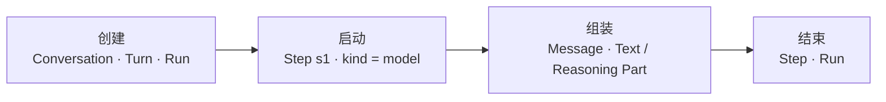
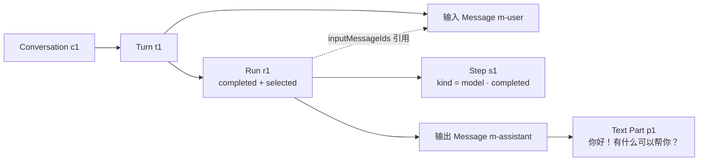

# 串联一次完整文本回答

开始前应依次完成 [Runtime 保存的对话状态](../concepts/snapshot-and-domain-model.md)、[根据已确认事实更新状态](../concepts/events-and-reducer.md)、[注册可用的模型接入](../concepts/provider-registration.md)、[准备一次模型调用](../concepts/model-call-projection.md)和[校验模型返回的文本流](../concepts/model-step-ingress.md)。这些页面已经介绍 Command、Provider Registration、调用投影、Ingress Guard、Domain Event 和 reducer。

本页把这些机制串成当前支持的一个 Run：它只包含一个 Model Step，并接收 text 以及模型可能提供的 reasoning 内容。

场景目标很简单：用户发送“你好”，Runtime 记录一次回答尝试，逐步接收“你好！有什么可以帮你？”，最终让 UI 从完成的 Snapshot 中读到回答。

## 从什么状态开始

应用先调用 `runtime.createConversation()`，由 Runtime 生成 Conversation ID 并通过 `conversation-created` 写入空 Snapshot。随后 `conversation.send()` 委托根 Runtime 的 `dispatch(send)`；用户输入和模型返回不会直接写入嵌套消息对象，而是依次形成内部 Event，再由 reducer 更新规范化实体表。

执行协调器只使用经过允许列表筛选的调用选项，直接调用 `LanguageModelV4.doStream()`，不使用 `streamText()`。返回结果只有 `.stream` 进入[模型流校验](../concepts/model-step-ingress.md)；该边界负责 text/reasoning 顺序、Provider ID 到 Runtime ID 的转换和数据清洗。



## 状态怎样一步步形成

对应的 Event 顺序是：

1. `conversation-created` → `turn-created` → `turn-input-message-created`，由 Turn 一次性记录 user Message 和已完成的 Text Part；
2. `run-created` 冻结对 user Message 的只读输入引用；
3. model `step-started` → `run-output-message-created`，由 Run 记录 assistant Message；
4. Guard 按实际 stream 发出 assistant text/reasoning Part Event 和唯一的 `run-terminated`，同时把当前 Step 和 Run 写成终态。

Reasoning 是可选的独立 Part：Provider 未产生标准 reasoning part 时，本例只有文本；实际产生时，它按 stream 观察顺序出现在 assistant Message 的 `partIds` 中，不会与最终文本拼成同一 Part。

正常 `finish(stop)` 场景用一个 `run-terminated` 事实同时完成当前 Model Step 和整次回答。若模型以 `tool-calls` 结束，reducer 改用独立的 `model-step-completed`，把 Step 写成 completed 而让 Run 保持 active；工具审批、执行和后续 Model Step 仍由后续能力负责。

最终关系是：



实线表示所有权，虚线表示只读输入引用。Turn 拥有 user Message，Run 只消费它，不能通过 Part Event 改写它；Run 拥有 Step 和自己产生的 assistant Message。`stepIds` 与 `outputMessageIds` 不按位置配对，长度也不要求相同。

## 最终 Snapshot

下面的对象使用当前 `RuntimeSnapshot` 公共类型中的真实字段。为了聚焦场景，示例使用较短的 ID，但没有发明另一套数据结构。

```ts
const snapshot: RuntimeSnapshot = {
  schemaVersion: 1,
  conversationsById: {
    c1: { id: 'c1', turnIds: ['t1'] },
  },
  turnsById: {
    t1: {
      id: 't1',
      conversationId: 'c1',
      inputMessageIds: ['m-user'],
      runIds: ['r1'],
      selectedRunId: 'r1',
    },
  },
  runsById: {
    r1: {
      id: 'r1',
      turnId: 't1',
      status: 'completed',
      stepIds: ['s1'],
      inputMessageIds: ['m-user'],
      outputMessageIds: ['m-assistant'],
      providerId: 'example-provider',
      modelId: 'example-model',
      capabilities: { streaming: true, reasoning: false },
      termination: 'stop',
      usage: { inputTokens: 6, outputTokens: 10 },
    },
  },
  stepsById: {
    s1: {
      id: 's1',
      runId: 'r1',
      kind: 'model',
      status: 'completed',
    },
  },
  messagesById: {
    'm-user': {
      id: 'm-user',
      turnId: 't1',
      role: 'user',
      partIds: ['p-user'],
    },
    'm-assistant': {
      id: 'm-assistant',
      turnId: 't1',
      runId: 'r1',
      role: 'assistant',
      partIds: ['p-assistant'],
    },
  },
  partsById: {
    'p-user': {
      id: 'p-user',
      messageId: 'm-user',
      kind: 'text',
      content: '你好',
      status: 'completed',
    },
    'p-assistant': {
      id: 'p-assistant',
      messageId: 'm-assistant',
      kind: 'text',
      content: '你好！有什么可以帮你？',
      status: 'completed',
    },
  },
  toolCallsById: {},
}
```

## UI 最终读取什么

UI 可以从 Turn 的 `inputMessageIds` 读取用户问题，从 `selectedRunId` 找到 `r1`，再按 `outputMessageIds` 和各 Message 的 `partIds` 读取当前回答。它不需要理解 Provider stream，也不需要维护第二份回答状态机。

这也是规范化状态的价值：Conversation、Turn、Run、Step、Message 和 Part 各自只有一份记录，所有权和执行引用通过不同 ID 数组明确表达。`Run.stepIds` 是 Step 顺序的唯一来源；`stepIds` 与 `outputMessageIds` 不按数组下标关联，也没有持久化的 Step → Message 关系。

当前示例不代表工具、重试、恢复或后续阶段延续已经可用，也不承诺多 Step Run 行为。

## 验证关键边界

如果 Run 已经终止，之后才到达的文本 delta 不得继续修改回答。reducer 返回原 Snapshot，保证终态不会被迟到数据污染。

安全边界同样可以从最终结果验证：Snapshot 只包含领域数据，不包含 credential、Authorization header、Provider 原始 request/response、SDK object 或 UI 草稿。

## 回归保护

- `test/reducer/run-lifecycle.test.ts` 保护实体创建、终态和 usage；
- `test/reducer/content-parts.test.ts` 保护文本精确追加、结束和终态后的迟到数据；
- `test/reducer/structural-sharing.test.ts` 保护不可变更新和引用稳定；
- `test/integration/text-run.test.ts` 保护从 Conversation Command 到最终 Snapshot 的首个 text/reasoning 垂直切片；
- `RuntimeSnapshot` 的代码级 API 注释示例保护同一公共结构的文档展示。

下一步进入[观察一次回答如何结束](./runtime-terminal-semantics/)，通过本地可重复场景比较正常完成、Provider 失败、调用方中止和协议中断。之后再使用[验证 DeepSeek 三种 API 格式](./deepseek-runtime/)，观察多个真实 Provider 接入怎样进入同一个 Runtime。
