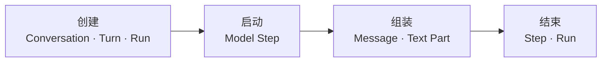
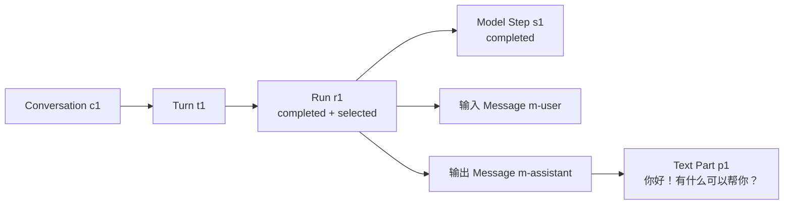

# 场景：一次完成的文本回答

本页把已经学过的 Snapshot、Domain Event 和 reducer 串成一次完整状态演进。开始前应先理解 [Snapshot 与领域模型](../concepts/snapshot-and-domain-model.md)和 [Domain Event 与 reducer](../concepts/events-and-reducer.md)。

场景目标很简单：用户发送“你好”，Runtime 记录一次回答尝试，逐步接收“你好！有什么可以帮你？”，最终让 UI 从完成的 Snapshot 中读到回答。

## 从什么状态开始

Runtime 已经准备好一个空 Snapshot。用户输入和模型返回不会直接写入嵌套消息对象，而是依次形成内部 Event，再由 reducer 更新规范化实体表。



## 状态怎样一步步形成

对应的 Event 顺序是：

1. `conversation-created` → `turn-created` → `run-created`；
2. `step-started`；
3. `message-created` → `text-part-started` → 一个或多个 `text-part-delta` → `text-part-ended`；
4. `run-terminated`，同时把当前 Step 和 Run 写成终态。

当前 reducer 用一个终止事实完成单 Step 文本回答。因此它可以表达“本次模型调用结束，同时整次回答结束”，但不能表达“当前 Step 已结束而 Run 继续执行”。需要多 Step 时，领域层必须分别表达 Step 终止与 Run 终止，不能继续复用一个合并事实。

最终关系是：



## 最终 Snapshot

下面的对象使用当前 `RuntimeSnapshot` 公共类型中的真实字段。为了聚焦场景，示例使用较短的 ID，但没有发明另一套数据结构。

```ts
const snapshot: RuntimeSnapshot = {
  schemaVersion: 1,
  conversationsById: {
    c1: { id: 'c1', turnIds: ['t1'] },
  },
  turnsById: {
    t1: {
      id: 't1',
      conversationId: 'c1',
      runIds: ['r1'],
      selectedRunId: 'r1',
    },
  },
  runsById: {
    r1: {
      id: 'r1',
      turnId: 't1',
      status: 'completed',
      stepIds: ['s1'],
      messageIds: ['m-user', 'm-assistant'],
      providerId: 'example-provider',
      modelId: 'example-model',
      capabilities: { streaming: true, reasoning: false },
      termination: 'stop',
      usage: { inputTokens: 6, outputTokens: 10 },
    },
  },
  stepsById: {
    s1: {
      id: 's1',
      runId: 'r1',
      index: 0,
      kind: 'model',
      status: 'completed',
    },
  },
  messagesById: {
    'm-user': {
      id: 'm-user',
      turnId: 't1',
      role: 'user',
      partIds: ['p-user'],
    },
    'm-assistant': {
      id: 'm-assistant',
      turnId: 't1',
      runId: 'r1',
      role: 'assistant',
      partIds: ['p-assistant'],
    },
  },
  partsById: {
    'p-user': {
      id: 'p-user',
      messageId: 'm-user',
      kind: 'text',
      content: '你好',
      status: 'completed',
    },
    'p-assistant': {
      id: 'p-assistant',
      messageId: 'm-assistant',
      kind: 'text',
      content: '你好！有什么可以帮你？',
      status: 'completed',
    },
  },
  toolCallsById: {},
}
```

## UI 最终读取什么

UI 可以从 `selectedRunId` 找到 `r1`，再按 `messageIds` 和各 Message 的 `partIds` 读取当前回答。它不需要理解 Provider stream，也不需要维护第二份回答状态机。

这也是规范化状态的价值：Conversation、Turn、Run、Message 和 Part 各自只有一份记录，关系通过 ID 明确连接。

## 验证关键边界

如果 Run 已经终止，之后才到达的文本 delta 不得继续修改回答。reducer 返回原 Snapshot，保证终态不会被迟到数据污染。

安全边界同样可以从最终结果验证：Snapshot 只包含领域数据，不包含 credential、Authorization header、Provider 原始 request/response、SDK object 或 UI 草稿。

## 回归保护

- `test/reducer/run-lifecycle.test.ts` 保护实体创建、终态和 usage；
- `test/reducer/content-parts.test.ts` 保护文本精确追加、结束和终态后的迟到数据；
- `test/reducer/structural-sharing.test.ts` 保护不可变更新和引用稳定；
- `RuntimeSnapshot` 的 TSDoc 示例保护同一公共结构的 API 文档展示。

## 检查你的理解

1. 为什么文本 delta 先形成 Event，而不是直接修改 Message？
2. UI 怎样从 `selectedRunId` 找到最终文本？
3. 如果未来一个 Run 包含多个 Step，当前哪个合并事实必须被拆开？

下一步阅读 [Provider 注册与安全边界](../concepts/provider-registration.md)，理解应用怎样向 Runtime 提供受信任的接入实例和模型目录。
