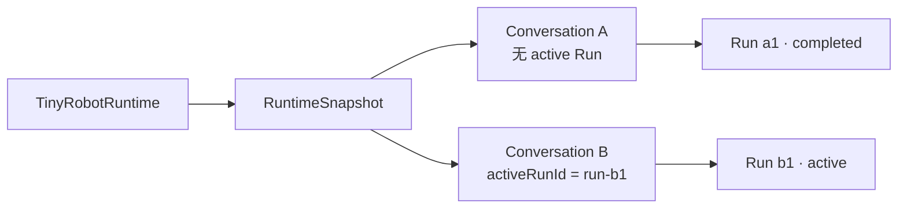
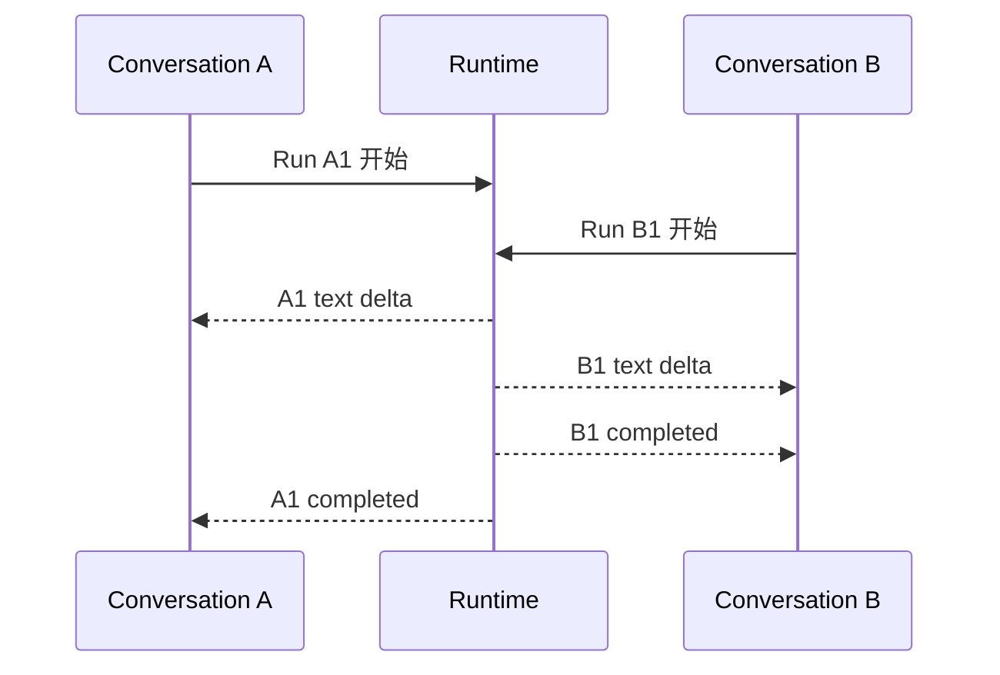

# 同时管理多段对话

<script setup>
import MultipleConversationsDemo from './MultipleConversationsDemo.vue'
</script>

本页用一个场景说明 Snapshot 的作用域和所有权隔离。开始前应先理解 [Runtime 保存的对话状态](../concepts/snapshot-and-domain-model.md)和[从状态中读取一段完整对话](../concepts/domain-selectors.md)。读完后，你应该能解释为什么切换页面正在展示的对话不会删除其他 Conversation，以及不同 Conversation 的运行怎样保持隔离。

Conversation 是一段可以连续追问的对话。一个 RuntimeSnapshot（Runtime 当前内存中的状态总账）可以同时包含多段当前已加载的 Conversation。

执行中的 Run 称为 **active Run**，所属 Conversation 用 `activeRunId` 指向它；Run 结束后，这个引用会被清除，但回答内容仍保留在 Snapshot 中。

## 场景

- Conversation A 已经回答完成；
- 用户切换到 Conversation B，并开始新的 Run；
- Conversation A 仍保留在 Snapshot 中；
- A 和 B 的实体通过 ID 所有权隔离。

下面的本地 Demo 会在一个 Runtime 中依次完成 A、B 两段回答。运行后切换当前展示项，可以观察 UI 选择只决定“看哪一段”，不会从 Snapshot 删除另一段。它不访问网络，也不验证并发协调；可以跳过并继续阅读领域关系。

<ClientOnly>
  <MultipleConversationsDemo />
</ClientOnly>



## UI 切换不会改变领域状态

```ts
const uiState = {
  selectedConversationId: 'conversation-b',
}

const snapshot = runtime.getSnapshot()

snapshot.conversationsById['conversation-a'] // 仍然存在
snapshot.conversationsById['conversation-b'] // 正在执行
```

`selectedConversationId` 属于 UI state，不需要写入 RuntimeSnapshot。Selector 用它选择需要展示的 Conversation。

## 两个 Conversation 可以并行

Runtime 契约允许不同 Conversation 各自有一个 active Run：

模型生成文本时会分批返回片段。下面序列图中的 **text delta** 就是一次到达的增量文本片段；它只会追加到所属 Run 的回答中。



同一 Conversation 则最多一个 active Run。这个约束用于防止两个回答同时争夺相同 Turn 和上下文，但当前执行能力尚未提供完整的并发拒绝或排队策略。本节说明的是领域作用域和已批准契约，不能被当作现行并发协调能力的验证。

## 回答完成后是否释放

Run B1 完成只会清除 Conversation B 的 `activeRunId` 并保留其结果，不会自动删除 Conversation A 或 B。

如果以后增加显式卸载或缓存淘汰策略：

- 必须是显式 Runtime 能力或明确的缓存策略；
- 必须说明未保存数据能否丢失；
- 必须与持久化恢复和 UI 选择状态配合；
- 不能由 reducer 在“新 Conversation 创建”时隐式猜测。

当前契约不定义 Conversation 卸载或缓存淘汰能力；上面的要求是引入这类能力时必须满足的领域边界。

## 边界场景：A 的 Event 错指向 B

Runtime 把已确认发生的内部事实记录为 Domain Event，并由 reducer 根据事实计算新 Snapshot；这两个概念已在运行边界页中介绍。如果一个携带 `run-a1` 的 Event 试图修改 Conversation B 所属的 Message 或 Part，reducer 必须把它视为所有权约束错误，而不是仅凭 ID 存在就接受。

`test/reducer/run-lifecycle.test.ts` 中的所有权回归测试用于防止这种跨 Conversation/Run 状态污染。

下一步阅读[根据已确认事实更新状态](../concepts/events-and-reducer.md)，理解这些所有权关系怎样在状态更新时得到保护。
