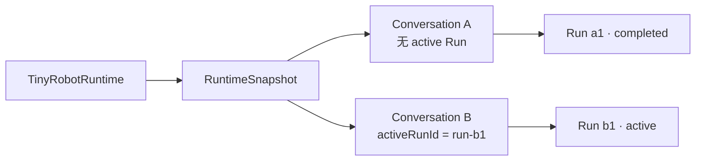
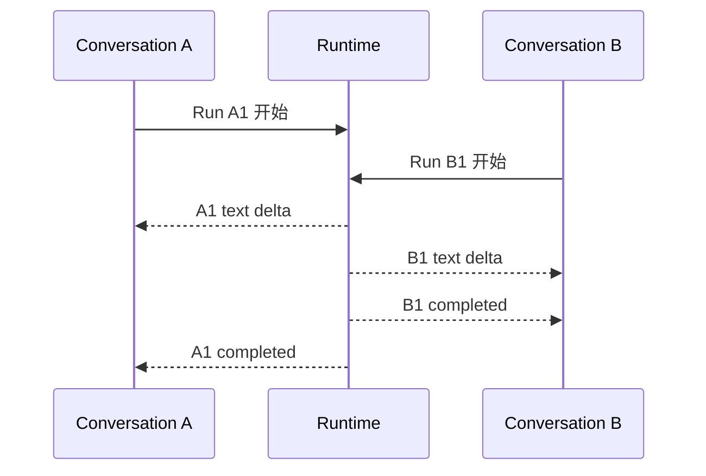

# 场景：多个 Conversation

本页验证 Snapshot 的作用域和所有权隔离。开始前应先理解 [Snapshot 与领域模型](../concepts/snapshot-and-domain-model.md)。读完后，你应该能解释为什么切换页面正在展示的对话不会删除其他 Conversation，以及不同 Conversation 的运行怎样保持隔离。

Conversation 是一段可以连续追问的对话。一个 RuntimeSnapshot（Runtime 当前内存中的状态总账）可以同时包含多段当前已加载的 Conversation。

## 场景

- Conversation A 已经回答完成；
- 用户切换到 Conversation B，并开始新的 Run；
- Conversation A 仍保留在 Snapshot 中；
- A 和 B 的实体通过 ID 所有权隔离。



## UI 切换不会改变领域状态

```ts
const uiState = {
  selectedConversationId: 'conversation-b',
}

const snapshot = runtime.getSnapshot()

snapshot.conversationsById['conversation-a'] // 仍然存在
snapshot.conversationsById['conversation-b'] // 正在执行
```

`selectedConversationId` 属于 UI state，不需要写入 RuntimeSnapshot。Selector 用它选择需要展示的 Conversation。

## 两个 Conversation 可以并行

不同 Conversation 可以各自有一个 active Run：



同一 Conversation 则最多一个 active Run。这个不变量防止两个回答同时争夺相同 Turn 和上下文。

## 回答完成后是否释放

Run B1 完成只会清除 Conversation B 的 `activeRunId` 并保留其结果，不会自动删除 Conversation A 或 B。

扩展显式 unload 或 cache policy 时：

- 必须是显式 Runtime 能力或明确 cache policy；
- 必须说明未保存数据能否丢失；
- 必须与持久化恢复和 UI 选择状态配合；
- 不能由 reducer 在“新 Conversation 创建”时隐式猜测。

当前契约不定义 unload 能力或 cache policy；上面的要求是引入这类能力时必须满足的领域边界。

## 边界场景：A 的 Event 错指向 B

如果一个携带 `run-a1` 的 Event 试图修改 Conversation B 所属的 Message/Part，reducer 必须把它视为所有权不变量错误，而不是仅凭 ID 存在就接受。

ownership 永久回归测试用于防止这种跨 Conversation/Run 状态污染。

## 检查你的理解

1. 页面当前选择的 Conversation 为什么不属于 RuntimeSnapshot？
2. 哪条不变量限制同一 Conversation 的并行 Run？
3. 一个错误 Event 为什么不能只凭目标 ID 存在就被接受？

下一步阅读 [Domain Event 与 reducer](../concepts/events-and-reducer.md)，理解这些所有权关系怎样在状态更新时得到保护。
