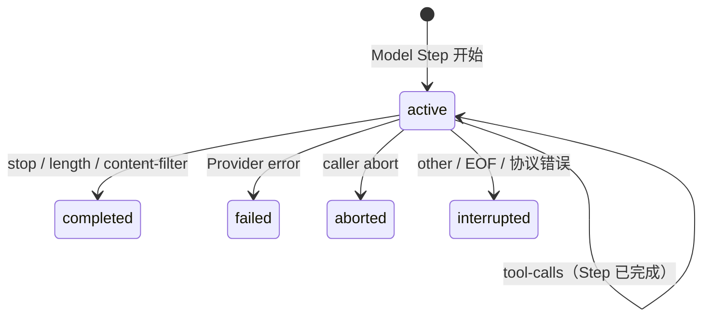

# 观察 Run 如何结束

模型流停止以后，消费者需要判断这次回答是成功、失败、用户中止，还是无法确认结果的中断。本页通过一组可重复运行的本地场景，让你先观察公共状态怎样变化，再解释这些结果由哪一层产生。

阅读前需要先理解 [Run 与 Model Step](../../concepts/snapshot-and-domain-model.md) 以及 [Ingress Guard](../../concepts/model-step-ingress.md)。完成本页后，你可以从公共 Snapshot 判断 Run 的结果，并区分 Run 与 Model Step 的生命周期。

## 先观察一次正常结束

在下面的 Demo 中保留“正常完成（stop）”，点击“运行场景”。先看左侧“执行过程”，再用右侧 JSON 核对对应阶段的公共状态。

这个 Demo 使用本地 Fake Provider，不访问网络，也不需要 API key。Fake Provider 只构造标准 `LanguageModelV4StreamPart`；后续处理仍经过真实的 Runtime、Ingress Guard、Domain Event 和 reducer。因此 JSON 展示的是 Runtime 实际产生的公共 Snapshot，不是页面预先写好的结果。

<ClientOnly>
  <RuntimeTerminalSemanticsDemo />
</ClientOnly>

“执行过程”是一段为了学习而放慢的 Snapshot 回放，不是 Runtime 的计时契约。每一项代表消费者实际观察到的一种状态：先创建回答任务，然后进入模型调用，最后形成稳定结果。当前项出现时，右侧 JSON 会同步切换到该阶段；短暂停留只是为了让状态变化可见，业务代码不能依赖具体时长。

正常完成时，你会依次看到：

1. Run 已创建，尚未开始模型调用；
2. Run 和当前 Model Step 都处于 `active`；
3. Model Step 与 Run 都变为 `completed`，Run 的 `termination` 为 `stop`。

Run 表示完成整次回答的业务尝试，Model Step 表示其中一次模型调用。单 Step 文本回答中二者通常一起结束，但它们不是同一个生命周期。

## 用状态图概括刚才的结果

这张图只概括本 Demo 中可观察的 Run 结果，不表示所有输入都来自同一种错误映射。`completed`、`failed`、`aborted` 和 `interrupted` 是 Tiny Robot 的稳定领域状态；Provider 或 AI SDK 的原始值不会直接成为 Snapshot。

现在再运行“达到输出上限（length）”和“内容过滤（content-filter）”。它们的 Run 仍然是 `completed`，但 `termination` 分别为 `max_output_tokens` 和 `content_filter`。消费者可以据此区分“完整回答”和“有结果但受边界影响”，而不需要读取 Provider 的 raw finish reason。

## 终态由模型输入和执行过程共同决定

Demo 中的场景对应真实业务，但来源不全是 AI SDK 的错误类型：

| Runtime 观察到的输入         | 典型业务场景                         | 稳定结果                                  |
| ---------------------------- | ------------------------------------ | ----------------------------------------- |
| AI SDK 标准 finish reason    | 正常停止、输出达到上限、内容策略限制 | `completed`，并保留规范化的 `termination` |
| Provider `error` stream part | 限流、认证失败或上游服务失败         | `failed`，只保留安全错误分类              |
| 流提前结束或协议顺序非法     | 网络断开、Provider 输出不完整        | `interrupted`                             |
| `runtime.abort()`            | 用户点击停止、调用方取消任务         | `aborted`                                 |
| AI SDK `tool-calls`          | 模型请求调用工具，回答尚未完成       | Model Step 完成，Run 继续保持 `active`    |

AI SDK Provider Adapter 先把厂商差异统一为标准 stream part 和 finish reason；Ingress Guard 再校验顺序并转换为 Tiny Robot 的 Domain Event。更完整的映射、EOF 判断和安全投影规则见[校验一次模型文本流](../../concepts/model-step-ingress.md)。

## 用两个边界校正判断

### 错误只留下稳定事实

运行“Provider 显式错误”。该场景构造包含动态 message、stack 和 HTTP 429 的 error part。最终 Snapshot 只出现稳定的 `rate_limit`、`provider_rate_limited`、`retryable` 与 `httpStatus`。动态错误文本、warning、raw finish reason 和 Provider metadata 都不会进入公共状态。

“意外 EOF”和“未知终止原因”则进入 `interrupted`。它们表示 Runtime 无法证明一次有效成功，也没有收到可归类为 Provider 显式失败的 error part。

### 用户中止具有独立语义

选择“用户主动停止”，点击“运行场景”，再在模型调用阶段点击“停止运行”。本地流会保持打开，直到页面调用 `runtime.abort(conversationId)`。最终 Run 为 `aborted`，错误代码为 `caller_aborted`；它不会被流关闭时产生的其他结果覆盖。

## 最后观察 Model Step 已结束而 Run 未结束

运行“等待工具调用（tool-calls）”。这一次 Model Step 会变为 `completed`，Run 则保持 `active`，termination 是 `tool_calls`。它对应“本次模型调用已经结束，但整次回答仍要等待工具流程”的业务状态，也证明 Run 和 Step 不能合并成一个状态。

当前 Demo 不执行工具，也不会创建下一个 Model Step；工具注册、审批、执行和多 Step 闭环属于后续 Runtime 能力。状态图中的 `tool-calls` 自环表示 Run 仍在等待后续流程，不表示同一个 Model Step 继续执行。

## 检查你的理解

1. 为什么 `length` 和 `content-filter` 对应的 Run 仍然是 `completed`？
2. Provider 显式错误、unexpected EOF 和用户停止为什么不能都归为同一种失败？
3. `tool-calls` 场景中，为什么 Model Step 已完成而 Run 仍是 `active`？

## 如何验证这个示例

永久回归测试 `docs-next/test/runtime-terminal-scenarios.test.ts` 通过公共 `createRuntime()` 运行相同 Fake Provider，验证 finish 映射、安全错误投影和 caller abort。Runtime 自身更底层的 exactly-one terminal、终态后静默、Part 必须闭合以及 usage 可用性等协议不变量，继续由 Ingress Guard 测试保护，不在交互界面里模拟内部违规细节。

至此，你已经能从 Snapshot 判断一次模型步骤怎样结束。需要接入真实远端模型时，下一步进入 [DeepSeek 三种 API 格式实际验证](../deepseek-runtime/)；需要核对精确规范时，查看 [LanguageModelV4 Boundary v1](../../design/language-model-v4-runtime-boundary-v1.md)。
