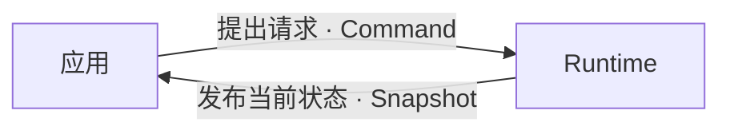
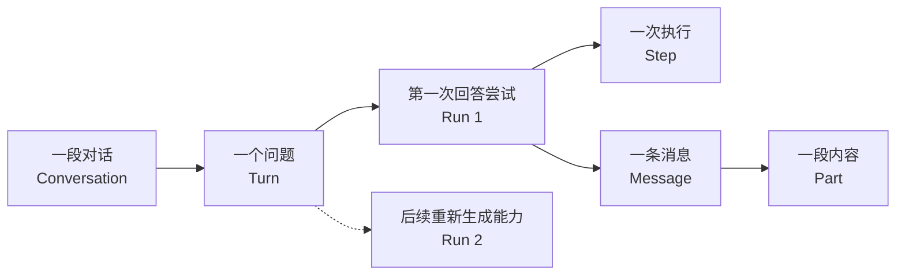
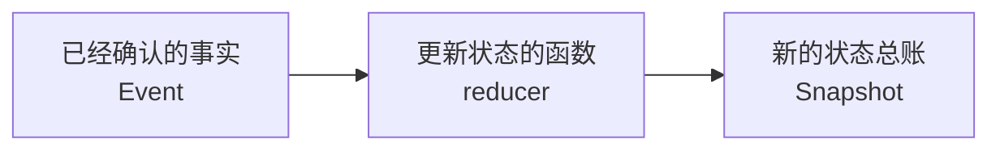
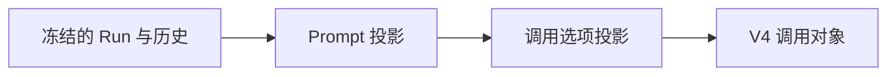

# 快速开始

本页沿用同一个天气问答场景，用三个连续步骤介绍 Runtime：先理解应用怎样提出请求，再理解问答状态怎样保存，最后理解这些状态怎样变成模型调用参数。

读完后，你应该能回答三个问题：应用怎样访问 Runtime、一次问答由哪些对象组成、模型返回内容后状态怎样变化。

## 第一步：理解公共边界

假设用户在聊天窗口里问：“北京今天天气怎么样？”应用不会直接修改对话数据，而是通过 Runtime 提出请求并读取结果。

| 文档中的词                           | 先这样理解                                                   | 在示例中是什么                     |
| ------------------------------------ | ------------------------------------------------------------ | ---------------------------------- |
| **Runtime**                          | 应用里的对话管理对象。它接收请求、推进回答流程并管理对话状态 | 管理聊天窗口背后数据的对象         |
| **Command**                          | 应用向 Runtime 提出的请求，不保证一定成功                    | “发送这个问题”“停止生成”           |
| **RuntimeSnapshot**（简称 Snapshot） | 一个 Runtime 此刻保存在内存中的全部对话状态                  | 页面读取问题、回答和运行状态的总账 |

应用和 Runtime 的公共关系可以先记成：

Runtime 还需要知道怎样调用模型，但不能长期保存 API key 或某个模型实例。

| 文档中的词                                 | 先这样理解                                                          |
| ------------------------------------------ | ------------------------------------------------------------------- |
| **Provider 连接配置**                      | 应用保存的 endpoint、Provider 类型、模型目录等连接资料              |
| **Provider 注册（Provider Registration）** | Provider 集成层构造、供 Runtime 解析的可信接入对象                  |
| **Provider**                               | 把统一的模型选择和调用方式适配到具体模型服务                        |
| **providerId / modelId**                   | 应用定义的接入实例标识，以及 Provider 接受的真实模型标识            |
| **LanguageModelV4**                        | Runtime 固定使用的 AI SDK 模型调用接口                              |
| **credential**                             | API key 一类的认证资料；由应用和 Provider 管理，不进入 Runtime 输入 |
| **capability**                             | 随模型 descriptor 复制到 Run 的 metadata；当前不参与调用 gate       |

这些名称的来源并不相同：`LanguageModelV4` 和 Provider ABI 直接来自 AI SDK；Command 借用 CQRS 中表达业务意图的概念；`RuntimeSnapshot` 的具体数据范围由 Tiny Robot 自己定义。出处和差异见[命名来源与项目定义](../reference/terminology-sources.md)。

::: tip 继续理解公共交互
先阅读 [Runtime 总览](../concepts/runtime-overview.md)，再进入 [Command 与 Runtime API](../concepts/commands-and-runtime.md)。需要核对模型选择、安全和凭据责任时，查看 [Provider 注册与安全边界](../concepts/provider-registration.md)。

按需核对：[下一代架构总览](../design/architecture-overview.md) · [ADR-0002：Provider 边界](../design/adr-0002-language-model-v4-provider-boundary.md) · [Runtime 契约](../design/runtime-contract.md)
:::

## 第二步：理解一段问答的数据

Snapshot 使用规范化的领域状态。仍以天气问题为例：

| 文档中的词       | Tiny Robot 中的定义                    | 在示例中是什么                                       |
| ---------------- | -------------------------------------- | ---------------------------------------------------- |
| **Conversation** | 一段可以连续追问的对话                 | 用户与助手关于天气的整段聊天                         |
| **Turn**         | 用户提出的一次问题或意图               | “北京今天天气怎么样？”                               |
| **Run**          | Runtime 为一个 Turn 生成答案的一次尝试 | 当前发送产生第一次回答；后续重新生成会创建另一次 Run |
| **Step**         | Run 中一次模型调用或一次工具执行       | 调用模型生成天气回答                                 |
| **Message**      | 由用户、助手或工具产生的一组内容       | 用户的问题，或助手的完整回答                         |
| **Part**         | Message 中最小的内容单元               | 一段文字、一次工具请求或一个错误                     |

它们之间最常见的关系是：

领域模型允许同一个 Turn 包含多个 Run，也允许一次 Run 包含多个 Step。当前已实现的 Send 只创建一个单 Step text/reasoning Run；重新生成、工具循环和 multi-Step 执行仍是后续能力。

Conversation、Turn、Run 和 Step 在不同产品中没有统一层级；上表是 Tiny Robot 的项目定义。Message 和 Part 借鉴 AI SDK 的内容结构，但 Runtime 类型不会直接复用 AI SDK 类型。

## 状态怎样变化

| 文档中的词                     | 直白定义                                             | 例子                                    |
| ------------------------------ | ---------------------------------------------------- | --------------------------------------- |
| **Domain Event**（简称 Event） | Runtime 内部已经确认发生的事实                       | “Run 已创建”“文字已追加”                |
| **reducer**                    | 根据“旧 Snapshot + 一个 Event”计算新 Snapshot 的函数 | 收到“文字已追加”后，把文字加入对应 Part |

文档把“reducer 根据 Event 产生新 Snapshot”简称为**归约**。这个词只描述状态计算，不表示压缩或删除数据。

Domain Event 借用领域驱动设计中“已经发生的领域事实”这一含义；reducer 和按 ID 组织状态的方式借鉴 Redux 的状态管理模式。Tiny Robot 仍为事件内容、实体所有权和生命周期定义自己的约束。

::: tip 继续理解状态
依次阅读 [Snapshot 与领域模型](../concepts/snapshot-and-domain-model.md)、[多个 Conversation](../examples/multiple-conversations.md)、[Domain Event 与 reducer](../concepts/events-and-reducer.md)和[一次完成的文本回答](../examples/completed-text-run.md)。这组页面先解释状态形状，再验证作用域，最后走通一次状态演进。

按需核对：[ADR-0004：Snapshot、Command 与 Domain Event 分工](../design/adr-0004-snapshot-command-event-runtime.md) · [Runtime 契约](../design/runtime-contract.md)
:::

## 第三步：准备模型调用

Runtime 把 Snapshot 中允许的历史投影为固定 V4 prompt，再构造完整的 allowlisted `LanguageModelV4CallOptions`。这个对象是模型调用边界的输入。

| 步骤                          | 负责什么                           | 产生什么                      |
| ----------------------------- | ---------------------------------- | ----------------------------- |
| prompt projection             | 按 Message/Part 顺序转换允许历史   | V4 prompt                     |
| model call options projection | 只组合批准的 output limit 和 abort | 完整 allowlisted call options |

遇到 unknown、未完成或无法完整表达的历史 Part 时，投影会稳定拒绝，而不是删除它再继续。这样可以保证模型看到的历史与 Runtime 已接受的历史一致。

::: tip 继续理解模型调用准备
先阅读 [Provider 注册与安全边界](../concepts/provider-registration.md)，再阅读[准备一次模型调用](../concepts/model-call-projection.md)。前者解释应用怎样提供接入实例和模型，后者解释 Runtime 怎样构造一次调用。

按需核对：[ADR-0002：Provider 边界](../design/adr-0002-language-model-v4-provider-boundary.md) · [LanguageModelV4 Boundary Contract v1](../design/language-model-v4-runtime-boundary-v1.md#4-capability-descriptor)
:::

## 检查你的理解

读完本页后，先不用查看源码，尝试回答：

1. 应用为什么通过 Command 请求变化，而不是直接修改 Snapshot？
2. Turn、Run、Step、Message 和 Part 在一次天气问答中分别表示什么？
3. 为什么 capability metadata 不参与当前调用 gate，而 Prompt 和调用选项仍必须经过 allowlist 投影？

如果其中一个问题还不能用自己的话回答，按照上方对应的“继续理解”路径进入详细页面。

## 参考资料

- 想核对名词依据：阅读 [命名来源与项目定义](../reference/terminology-sources.md)。
- 想查看已经实现的公共类型：阅读 [Runtime API 与 TSDoc](../reference/runtime-api.md)。
- 想参与文档评审：阅读[学习文档评审指南](../contributing/learning-document-review.md)。
