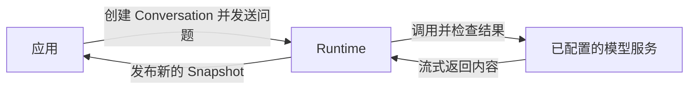

# 提交问题并读取回答

<script setup>
import QuickStartDemo from './QuickStartDemo.vue'
</script>

Tiny Robot Runtime（下文简称 Runtime）是应用中的 AI 对话运行对象。应用把用户问题交给它；它调用已经配置的模型服务、检查返回结果，并保存页面可以查询的当前状态。这份只读状态称为 **Snapshot**。

本页假设应用已经创建并配置好一个 `TinyRobotRuntime`。你将提交一个问题，再从 Snapshot 读取回答；不需要预先了解状态内部怎样更新或不同模型服务使用什么协议。

## 问答过程中的四个基本对象

在运行 Demo 和代码前，先认识当前场景需要的四个对象：

| 对象             | 当前场景中的含义                                       |
| ---------------- | ------------------------------------------------------ |
| **Conversation** | 一段可以继续追问的对话。Runtime 为它分配 ID。          |
| **Turn**         | 用户在 Conversation 中表达的一次意图，并拥有这次输入。 |
| **Run**          | Runtime 为完成某个 Turn 而发起的一次回答尝试。         |
| **Snapshot**     | Runtime 已接受的全部对话状态。页面只从这里读取结果。   |

Turn 和 Run 的区别在于：Turn 保存“用户想完成什么”以及表达该意图的用户 Message；Run 记录“Runtime 为这个意图进行了哪一次执行”。Run 会引用它实际使用的输入，并产生自己的 assistant 输出。用户提出新的问题会创建新的 Turn；如果以后为同一个意图重试或重新生成回答，则会在原 Turn 中复用用户输入并创建新的 Run。本页的一次 `send()` 只创建一个 Turn 和一个 Run。

Run 会经历运行中和已结束等状态。Demo 中的 `completed` 表示这次回答已经正常结束，页面可以读取最终文本。

## 体验一次本地问答

下面的 Demo 使用浏览器内的固定回答，不访问远端模型服务，也不需要 API key。提交问题后，可以观察回答文本和 Run 从运行中变为 `completed`。Demo 用于快速建立直觉，可以跳过。

<ClientOnly>
  <QuickStartDemo />
</ClientOnly>

## 创建对话并发送问题

代码使用两个公共方法：

- `runtime.createConversation()` 不接收参数，创建一段空 Conversation，并返回绑定该 Conversation ID 的便利对象；它本身不保存回答内容。
- `conversation.send()` 接收用户文本和模型选择，请求 Runtime 在这段 Conversation 中生成回答。返回的 Promise 会在本次 Run 结束或请求被拒绝后完成，回答仍保存在 Snapshot 中。

`send()` 输入中的 `providerId` 选择应用已经配置的模型接入，`modelId` 选择该接入公开的真实模型。连接地址、请求头和 API key 由应用配置，不进入本次调用。

```ts
const conversation = runtime.createConversation()

await conversation.send({
  providerId: 'deepseek-compatible',
  modelId: 'deepseek-chat',
  content: '请用一句话介绍北京的气候特点。',
})
```

调用完成后，`conversation.id` 仍然只是定位这段对话的 ID。下一步需要从 Runtime 当前的 Snapshot 查询实际回答。

## 查询这段对话的结果

`runtime.getSnapshot()` 返回 Runtime 当前的只读状态。Snapshot 为了稳定更新，把不同对象按 ID 分开保存；页面通常不直接查这些表，而是使用查询函数把相关记录组合起来。

`selectConversation(snapshot, conversationId)` 就是这样的查询函数。它接收一个 Snapshot 和 Conversation ID；如果对话存在，就返回按照业务顺序组织的整段对话，否则返回 `undefined`。

`selectConversation()` 返回的 `turns` 按用户意图的发生顺序排列。每个 Turn 保存针对该意图产生的全部 Run；`selectedRun` 是当前被采用、准备展示给用户的那次回答尝试。

```ts
import { selectConversation } from '@opentiny/tiny-robot-runtime/selectors'

const result = selectConversation(runtime.getSnapshot(), conversation.id)
const latestTurn = result?.turns.at(-1)
const answer = latestTurn?.selectedRun
```

**Message** 是由用户、助手或其他角色产生的一条消息；**Part** 是 Message 中的一段有类型内容。把 Message 划分为 Part，能够在不改变消息顺序的前提下区分普通文本和其他模型输出。

正常完成后，`answer` 提供以下业务结果：

- `status` 为 `completed`，表示回答正常结束；
- `termination` 记录模型停止生成的原因，例如 `stop`；
- Turn 的 `inputMessages` 保存用户问题，`answer.outputMessages` 保存本次 Run 产生的助手回答；
- 每条 Message 的 `parts` 保存有序内容，其中 `kind: 'text'` 的 Part 是展示给用户的回答文本；
- `providerId` 和 `modelId` 记录这次回答选择的接入与模型。

## 文本与推理内容

模型调用可以产生两类与当前问答有关的内容：

- **text** 是面向用户的最终回答内容；
- **reasoning** 是部分模型能够提供的中间推理内容，与最终回答分开保存。它是否可用取决于模型和接入能力，应用不应把它假定为每次回答都会出现。

一次 Run 可以由一个或多个执行阶段组成，文档把每个阶段称为 **Step**。调用模型并接收 text 或 reasoning 的阶段称为 **Model Step**。当前 `send()` 创建一个 Run，并在其中执行一个 Model Step；更复杂的多 Step 流程不属于本页范围。

现在可以把本页对象连成一条关系：Conversation 包含 Turn；Turn 拥有用户输入并关联一个或多个 Run；Run 引用执行输入，拥有 Step 和本次产生的输出 Message；Message 再包含 Part。后续页面会解释这些对象为什么按 ID 保存在 Snapshot 中。

## 应用与 Runtime 的责任边界



应用负责发起问题和读取状态，Runtime 负责调用模型、检查结果并更新 Snapshot。页面不能一边消费模型原始响应，一边自己拼装第二份回答状态；否则页面状态可能与 Runtime 已接受的结果不一致。

调用方可以选择已配置的 `providerId` 和 `modelId`，但不能通过 `send()` 注入任意请求头、模型服务专用选项或原始模型 SDK 对象。详细边界会在[注册可用的模型接入](../concepts/provider-registration.md)中说明。

下一步阅读[应用与模型之间的运行边界](../concepts/runtime-overview.md)，理解这条链路为什么需要分层。需要直接查询精确签名时，进入 [Runtime API 与 TSDoc](../reference/runtime-api.md)。
